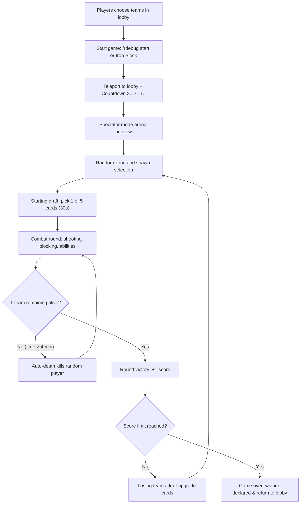

# RoundsPlugin — The [ROUNDS](https://store.steampowered.com/app/1557740/ROUNDS/) Minigame in Minecraft

> **Language:** [Русский](readme.md) · English  
> Inspired by [**Rounds In Minecraft**](https://minecraft-inside.ru/maps/169501-rounds-in-minecraft.html) by **ifrit**.

**RoundsPlugin** brings the chaotic, competitive 2D/3D platformer shooter [**ROUNDS**](https://store.steampowered.com/app/1557740/ROUNDS/) directly to your Minecraft server! 4 teams, a deep card system with 116 unique upgrade cards and custom card support, up to 20+ rounds, physical interactive setup blocks, comeback card drafting for losing teams, auto-death for stalled rounds, freeplay mode, and full [**TAB**](https://www.curseforge.com/minecraft/mc-mods/tab) / [**PlaceholderAPI**](https://modrinth.com/mod/placeholderapi) integration.


## Key Features

- **Team Firefights (Up to 4 Teams):** Blue, Red, Yellow, and Green teams + seamless spectator mode.
- **Custom Weapon (Gun & Shield):**
  - **Left Click:** Fires physics-driven bullets with ricochets, bullet speed, and card effects.
  - **Right Click:** Raises shield to deflect bullets and trigger explosive counter-abilities.
  - **Q (Drop Key):** Manually reload your magazine with a live Action Bar progress bar.
- **116 Unique Upgrade Cards:**
  - Massive ability catalog: homing bullets, poison clouds, frost slow, wall drills, executions, close-range saw shredding, and second-wind revives.
  - 5 rarity tiers: `COMMON`, `UNCOMMON`, `RARE`, `EPIC`, `LEGENDARY` with configurable weights.
  - Support for variations (single card with scaling stats across rarities).
  - **Comeback Mechanics:** The losing team drafts a new card between rounds.
  - Configurable card selection timer (`/rdebug cardchoicetime <sec>`) with warning sounds (XP sound on last 5 seconds, anvil on final second) and auto-kick for inactive players.
  - In-game deck inventory viewer (`/rdebug cards show`) and administrative card management.
  - Card rotation during draft (Wheel mode).
- **Physical Block Setup:** Special interactive blocks for team selection, lobby, arena zones, spawns, jump pads, and elevator lifts.
- **Native Smart Bots (Fast NMS Fake Players with 10 Difficulty Levels):** Server-side combat bots for solo practice and duels (`/rdebug bot spawn [name] [team] [1..10]`, `/rbot`).
  - **Dynamic Difficulty (Levels 1..10):** Random level assigned to each bot and rerolled every round (`factor = level / 10.0`).
  - **Combat Archetypes (Playstyles):** 4 distinct playstyles chosen randomly each round: `AGGRESSIVE_FLANKER`, `TACTICAL_SNIPER`, `DEFENSIVE_TURTLE`, `ERRATIC_BRAWLER` (juking every 26-46 ticks with smooth movement curves).
  - **Anti-Wallhack Vision & Pursuit:** 140° visual cone, 60m range, 2.5m footstep hearing, raycast line-of-sight checks. Scaled pursuit tenacity: Levels 1–2 (69%), 3–4 (82.8%), 5–7 (96.6%), 8–10 (100%). Pursuit timeout of 120 ticks (6 seconds).
  - **Humanized Physics & Damage Reaction:** Horizontal movement inertia with acceleration and deceleration curves, natural eased crosshair tracking. Bots smoothly turn toward incoming fire with a human reaction delay (150–350 ms) without 0-tick view snaps. Accuracy scales by level: from ±45° spread at level 1 to ±4.5° at level 10.
  - **Fair Jump Pad Parrying:** Level 5+ bots predict jump pad contact 10–20 ticks ahead and raise shield with a 50% chance. Cleanly parries 20% max HP damage (0 damage taken), plays shield parry sound, and launches the bot upward. No cheat cooldown resets (`canBlock()` is strictly respected).
  - **Anti-Stacking, Stair Navigation & Red Zones:** Anti-stacking dislodges bots if they land on top of players and prevents jumping on entity hitboxes. Block staircase recognition (`isBlockStaircase`) improves stepped ascents and descents by +30%, maintains mid-air forward momentum, and eliminates first-attempt rollbacks on stairs and parkour. In enclosed rooms (from 1x1x1 to 5x5), bots search for block stairs and parkour exits upward, or mark dead-ends as Red Zones for 60 seconds (`RedZone`) and never re-enter during patrol (entry is only allowed during active combat pursuit; exiting from inside is always unobstructed). In 1x1 pockets and at wall corners, bots immediately snap rotation to open space (up to 45°/tick) and pause forward momentum, eliminating corner staring and wall reading (`isInsideCorner`).
  - **Tactical Cover & Ambushes:** When below 20% HP, bots seek cover within 4–6.5 blocks. Around corners, they establish tactical ambushes, aiming down corridors with pre-raised shields.
  - **Jump Pad Ballistics:** Intentional pad usage is banned during the initial 3–15 seconds of a round. Bots scan for safe landing platforms in mid-air and steer toward them.
  - **High Performance & Bulk Limits (192+ and up to 500 Bots):** Precomputed `CombatProfile` lookup matrices (O(1)), shared `ArenaNavMesh`, two-stage target filtering (FOV & distance checks prior to raycasting, cutting 99% of block collision queries), adaptive 4-tier LOD down to 5 TPS for distant entities, and O(1) batch scoreboard team synchronization guarantee rock-solid 20 TPS with zero freeze spikes even on entry-level servers (3 CPU cores / 4 GB RAM). Bulk spawn limit supported up to 500 bots.
  - **Arena Team Detection:** Bots automatically balance only across teams that have physical wool blocks placed in the lobby/arena.
  - **Card Synergy & Saw Rush:** With the Saw card, bots sprint in point-blank (<2.8m, speed 0.46) while blocking. Bots dynamically cast Implode, Silence, EMP, Overpower, BombOnBlock, Teleport, Heal, and Tactical Reload. Enemy highlights from "Mark Was Good" are limited to 10 seconds upon moving away, and FakeBot ticks active potion effects normally.
  - **Automatic Cleanup & RAM Release:** All bots despawn cleanly when games stop (`/rdebug stop`, `/rounds stop`), when bots are removed, or on reload. All manager references are severed, NMS entities are cleanly discarded, and `System.gc()` is triggered to immediately release virtual memory back to the hosting OS kernel.
  - **Spectator Outlines & Team Titles:** Spectators see glowing outlines around alive players in team colors (hidden from survival combatants). Neutral team victory titles are shown to spectators.
- **Combat Hit Visual Feedback:**
  - Hitting an enemy flashes their 3D model bright red with a hurt animation (`playHurtAnimation`) and directional tilt away from the damage vector.
  - Taking damage tilts the player camera toward the attack origin and triggers a smooth red screen border vignette (`WorldBorder` warning).
- **Team-Only Nametags & Heart Count Display:**
  - Nametag and TAB format: `<hearts>♥ <Name>` for players and `<hearts>♥ <Name> [L<level>]` for bots.
  - Enemy nametags are completely hidden during active rounds (only teammates can see each other's nametags). Spectators can see everyone's nametags.
  - Player ping in TAB is colored according to their team color (`%rounds_ping%` for fancy formatted text, `%rounds_ping_raw%` for numeric slots). Objective values in TAB remain protected from color code parsing errors.
- **Integration & Built-in Scoreboard:**
  - Built-in scoreboard is enabled by default when TAB is not present, and automatically disables itself if TAB plugin is detected to avoid conflicts. Can be permanently disabled via `config.yml`.
  - Automatically alternates every 5 seconds between Match Score (team wins) and Player Stats (HP, DMG, Cards, Bullets, Max Ammo).
  - Operates completely autonomously without requiring PlaceholderAPI thanks to native stat calculation, utilizing double objective buffering for zero flicker.
  - Full optional support for [**TAB**](https://www.curseforge.com/minecraft/mc-mods/tab) and [**PlaceholderAPI**](https://modrinth.com/mod/placeholderapi).
- **Localization:** Complete UI and card translation system (`lang/*.txt`).


## System Requirements

- **Server:** Paper / Purpur 1.20.4+ (compatible with 1.20.x — 1.21.x / 26.2+)
- **Java:** Java 17 bytecode (major version 61)
- [**PlaceholderAPI**](https://modrinth.com/mod/placeholderapi) and [**TAB**](https://www.curseforge.com/minecraft/mc-mods/tab) (Optional; the plugin itself can also display core data, should you wish to customize things further)


## Installation

1. Place `RoundsPlugin.jar` into your server's `plugins/` directory.
2. Restart the server to generate configuration files.
3. Configure `plugins/Rounds/config.yml` if needed.
4. Add custom cards to `plugins/Rounds/cards/custom/` (optional).
5. Join the server as an administrator (`rounds.admin` or OP), run `/rdebug giveblocks`, and place the interactive blocks.


## Quick Start: Setting up an Arena

### 1. Get Setup Blocks

Run:
```
/rdebug giveblocks
```
You will receive stacks of all special blocks, and your game mode will automatically switch to **Creative**.

### 2. Special Blocks Reference

#### Team Selection Blocks (Lobby)
Players step on colored wool blocks in the lobby to select a team.

| Block | Item / Material | Purpose |
|-------|-----------------|---------|
| **Join Blue Team** | Light Blue Wool (`LIGHT_BLUE_WOOL`) | Join Blue Team |
| **Join Red Team** | Red Wool (`RED_WOOL`) | Join Red Team |
| **Join Yellow Team** | Yellow Wool (`YELLOW_WOOL`) | Join Yellow Team |
| **Join Green Team** | Lime Wool (`LIME_WOOL`) | Join Green Team |
| **Leave Team (Spectator)** | White Wool (`WHITE_WOOL`) | Leave all teams and become a spectator |

#### Arena, Lobby, and Spawn Blocks

| Block | Item / Material | Purpose |
|-------|-----------------|---------|
| **Lobby Block** | Emerald Block (`EMERALD_BLOCK`) | Lobby center point. Player return position before/after matches. Only 1 active lobby block exists per world. Can also be set via `/rdebug setlobby`. |
| **Map Zone 50x50** | Diamond Block (`DIAMOND_BLOCK`) | Center of a 50x50 block arena zone. |
| **Map Zone 100x100** | Emerald Block (`EMERALD_BLOCK`) | Center of a 100x100 block arena zone. |
| **Spawn Block** | Obsidian (`OBSIDIAN`) | Team spawn point within the arena zone. |
| **Jump Pad Block** | Coal Block (`COAL_BLOCK`) | Deals 20% max HP damage (can be parried with shield) and launches entities high into the air. |
| **Elevator Lift Block** | Purple Glazed Terracotta (`PURPLE_GLAZED_TERRACOTTA`) | Slowly lifts players upward for a set duration. |

#### Game Control Blocks

| Block | Item / Material | Purpose |
|-------|-----------------|---------|
| **Game Start Block** | Iron Block (`IRON_BLOCK`) | Starts the match when stepped on. |
| **Game Stop Block** | Redstone Block (`REDSTONE_BLOCK`) | Forcibly terminates the game and resets state. |

### 3. Step-by-Step Arena Setup

1. **Lobby:** Place the **Lobby Block** in your waiting area and place colored wool blocks on the floor for team selection.
2. **Map Zones:** Place one or more **Map Zone Blocks** (50x50 or 100x100) at the centers of your combat arenas. The plugin chooses a random zone each round.
3. **Team Spawns:** Place **Spawn Blocks** (Obsidian) inside each zone where teams will appear each round.
4. **Interactive Blocks (Optional):** Place Jump Pads and Elevator Lifts manually or select cuboids using `/rdebug jumppos1` / `jumppos2` / `jumpset` and `/rdebug uppos1` / `uppos2` / `upset`.


## Gameplay Flow



1. **Preparation:** Players step on their team's wool block.
2. **Start:** An administrator runs `/rdebug start` or steps on the Iron Block.
3. **Countdown:** A 3-second countdown starts in chat. Players enter spectator mode for a map overview.
4. **Card Draft:** Players choose 1 card from 5 options within 30 seconds (configured via `/rdebug cardchoicetime <sec>`). All players and bots are completely immobile and invulnerable during the draft.
5. **Combat:** Players receive guns, switch to survival, and fight on the selected arena.
6. **Round End:** The team of the last surviving player receives a round point.
7. **Upgrade Phase:** Losing teams open a card selection GUI to power up before the next round (all participants remain immobile and invulnerable during selection).
8. **Match Victory:** The first team reaching the required round wins (default 5) wins the match and everyone returns to the lobby.


## Configuration (`config.yml`)

```yaml
# ==============================================================================
# Rounds Plugin Configuration
# ==============================================================================

# Language configuration: file name from plugins/Rounds/lang/ without .txt
language: EN_en

# Default player stats (reset each round before cards apply)
defaults:
  damage: 3.0            # Base bullet damage
  attack-speed: 20       # Attack cooldown in ticks (20 ticks = 1 sec, lower = faster)
  attack-speed-modifier: 0
  attack-range: 0        # Extra projectile range
  ammo: 3                # Starting ammunition
  max-ammo: 3            # Maximum magazine size
  bullets: 1             # Projectiles fired per shot (1 = single, >1 = shotgun)
  hp: 20                 # Starting health points
  bullet-speed: 1.0      # Projectile velocity multiplier
  reload-speed: 0        # Reload speed modifier

# Match and round settings
game:
  default-rounds: 5      # Default rounds required to win the match
  countdown-seconds: 3   # Round start countdown in seconds
  round-time-seconds: 180 # Main round time in seconds before sudden death (default: 180s = 3 min)
  card-choice-time: 30   # Card selection timer in seconds (min 10)
  card-selection-time: 200 # Inventory GUI display duration in ticks
  respawn-delay: 5       # Respawn delay in ticks
  auto-death:
    enabled: true        # Sudden death for stalled rounds
    delay-seconds: 240   # Delay before first death event (240s = 4 min)
    interval-seconds: 60 # Interval between subsequent warnings and deaths
    bossbar: true        # Boss bar countdown at the top of the screen

# Participating teams
teams:
  enabled:
    - BLUE
    - RED
    - YELLOW
    - GREEN

# Weapon and shield settings
gun:
  material: CROSSBOW     # Primary weapon item material
  base-cooldown: 20      # Attack cooldown in ticks

shield:
  duration-ticks: 20     # Shield duration in ticks (20 ticks = 1.0s)
  cooldown-ms: 10000     # Shield cooldown in milliseconds (10s)
  no-party-cooldown-ms: 30000 # No Party card cooldown in milliseconds (30s)
  no-party-radius: 5.0   # No Party pulse radius in blocks

# Card drafting
cards:
  selection-count: 5     # Cards offered in draft GUI
  weighted-rarity: true  # Card rarity weight scaling

# Fake player bots
bots:
  bulk-limit: 500        # Maximum bots spawned per command
  vision:
    fov-degrees: 140.0   # Visual FOV cone in degrees
    max-distance: 60.0   # Maximum vision distance in blocks
    proximity-hearing: 2.5 # Footstep hearing radius in blocks
  jump-pad-parry:
    chance: 0.50         # Jump pad shield parry chance (50%)
    min-level: 5         # Minimum difficulty level required (level 5+)

# Arena blocks
jump-block:
  damage-percent: 20.0   # Damage taken upon landing (% max HP, parried with shield)
  launch-height: 10.0    # Vertical launch height in blocks

up-block:
  lift-speed: 0.3        # Upward elevator velocity
  duration-ticks: 40     # Elevator lift duration in ticks (40 ticks = 2s)

# World game rule overrides
game-rules:
  enabled: true
  instant-respawn: true
  keep-inventory: true
  freeze-time: true
  disable-weather: true
  disable-mob-spawning: true

# Name colors
color-nicknames: true

# Built-in scoreboard (enabled by default, automatically disabled if TAB is present)
builtin-scoreboard:
  enabled: true
  title: "&6&lROUNDS"
  stats-title: "&b&lМои статы"

# Allow non-admin players to execute safe commands for practice and matches
# Open to all: /rdebug join, info, status, state, stats show, cards show, statsend
# Unlocked with freeplay: true: /rdebug start, stop, rounds, givegun, wheel, bossbar, bot, /rbot
# Strictly admin-only (rounds.admin / OP): cards add/reload, stats add, freeplay, autodeath, cardchoicetime, setlobby, giveblocks, jump/up zones, setlanguage
freeplay:
  enabled: false
```


## Card System

Cards are stored as individual YAML files:
- `plugins/Rounds/cards/original/` — Built-in cards (116 files).
- `plugins/Rounds/cards/custom/` — Custom cards.

### Example Standard Card (`burst.yml`)
```yaml
id: 8
name:
  ru: "&aОчередь"
  en: "&aBurst"
description:
  ru: "+2 пули, +3 патрона, -60% урона, +10% к времени перезарядки"
  en: "+2 Bullets, +3 Ammo, -60% DMG, +10% Reload time"
material: ARROW
enabled: true
variations:
  - rarity: COMMON
    effects:
      bullets: 2
      ammo: 3
      damage: -0.6
      reload: 1
```

### Example Variable Card (`combine.yml`)
```yaml
id: 13
name:
  ru: "&4Объединение"
  en: "&4Combine"
description:
  ru: "+{0} урона, -{1} патрона, +{2} к перезарядке"
  en: "+{0} DMG, -{1} Ammo, +{2} Reload time"
material: REDSTONE
enabled: true
variations:
  - rarity: COMMON
    values: ["50%", "1", "5%"]
    effects:
      damage: 0.5
      ammo: -1
      reload: 0.5
  - rarity: UNCOMMON
    values: ["75%", "2", "8%"]
    effects:
      damage: 0.75
      ammo: -2
      reload: 0.8
  - rarity: RARE
    values: ["100%", "2", "10%"]
    effects:
      damage: 1.0
      ammo: -2
      reload: 1.0
  - rarity: EPIC
    values: ["125%", "3", "13%"]
    effects:
      damage: 1.25
      ammo: -3
      reload: 1.3
```

### Card Effect Keys Reference

| YAML Key | Effect Description |
|----------|-------------------|
| `damage` | Damage multiplier (+0.5 = +50% damage, -0.6 = -60%) |
| `attack-speed` | Attack cooldown reduction |
| `attack-speed-reload` / `reload` | Reload time delay modifier |
| `attack-range` | Projectile range bonus |
| `bullets` | Extra bullets fired per shot |
| `ammo` | Magazine capacity bonus |
| `bullet-speed` | Projectile velocity multiplier |
| `bounce` | Number of wall/floor ricochets |
| `target-bounce` | Projectiles bounce toward nearest enemy |
| `damage-per-bounce` | Bonus damage per bounce |
| `hp` | Maximum health multiplier (+0.5 = +50% HP) |
| `hp-cost` | Health consumed per shot (% max HP) |
| `cold` / `cold-level` | Freeze chance and amplifier |
| `poison` / `poison-level` | Poison chance and amplifier |
| `toxic-cloud` | Poison cloud spawned on hit |
| `parazit` / `parazit-level` | Wither chance and amplifier |
| `leech` | Lifesteal percentage of dealt damage |
| `homing` | Homing strength toward opponents |
| `homing-on-block` | Homing buff for N seconds after raising shield |
| `empower` / `empower-charge` | Next shot damage buff after blocking |
| `dark-strength` | Stacking dark energy damage bonus (+0.5 per stack) |
| `big-bullet` | +70% projectile hitbox size, +30% reload time |
| `bomb-bullet` | Explosion spawned at impact location |
| `bomb-on-block` | Bombs spawned around player upon shield raise |
| `explode-bullets` | Area of effect explosion damage on impact |
| `shield` | Shield capabilities |
| `shield-charge` | Extra shield block charges |
| `double-block` | Double block charge |
| `shields-up` | Auto-shield trigger when clip is emptied |
| `block-cd` / `shield-cooldown` | Shield cooldown reduction |
| `reload-speed` | Reload speed bonus (up to 0.95) |
| `tactical-reload` | Instant weapon reload on shield block |
| `auto-reload` | Passive ammo regeneration over time |
| `truster` / `truster-lvl` | Increased bullet knockback strength |
| `jump-height` | Jump height modifier |
| `grow` | Increased HP pool and model scale |
| `speed` / `speed-boost` | Movement speed bonus |
| `stun` | Target stun duration on hit |
| `heal` | Periodic health regeneration |
| `saw` | Saw: damaging fiery ring around player while blocking |
| `shockwave` | Shockwave: strong knockback burst on block |
| `implode` | Implode: pulls nearby enemies toward player on block |
| `silence` | Silence: prevents enemy shooting and shields |
| `silence-aura` | Persistent silence aura |
| `sneaky` | Stealth / invisibility |
| `emp` | EMP: heavy slow applied to enemies on block |
| `overpower` | Overpower: AoE damage based on current HP on block |
| `refresh` | Instant shield cooldown reset and ammo refill |
| `radiance` / `highlight` | Glowing outline effect applied to enemies |
| `lifesteal-aura` | Persistent health drain aura |
| `phoenix` | Phoenix: automatic revival upon fatal damage |
| `abyssal` | Abyssal: phantom summoner if stationary for 10s |
| `drill` | Drill: bullets pierce walls and terrain |
| `teleport` | Teleport forward along look direction on block |
| `ammo-per-hit` | Ammo restored on successful hit |
| `hp-boost-on-hit` | Max HP increased on hit |
| `pristine-perseverance` | Health bonus while at full HP |
| `blood-furry` | Fury: stat buffs upon taking damage |
| `executioner` | Executioner: execute damage against low HP targets |
| `storm-caller` | Lightning strike summon on hit |
| `evasion` | Incoming damage dodge chance |
| `chameleon` | Invisibility when standing still |
| `snowball` | Snowball: stacking bonuses for consecutive wins |
| `skyfall` | Skyfall: AoE slam upon high landing (no fall damage) |
| `berserk` | Berserk: stats scale inversely with health |
| `overheat` | Overheat: shoot past empty clip at the cost of health |
| `second-wind` | Second Wind: survive lethal blow at 1 HP with invulnerability |
| `spikes` | Spikes: return damage to attacker |
| `bullet-rain` | Bullet Rain: rapid projectile spray and clip expansion |
| `frost-armor` | Frost Armor: slows attacking enemies |
| `no-party` | No Party: disables shields and reloads for nearby enemies |
| `blood-cartridge` | Blood Cartridge: emergency shooting with empty ammo sacrificing % HP (7..15%), bonus damage and crits |
| `spite-razorwire` | Spite Razorwire: release fan of spikes upon taking any damage (4..8 shards, on Epic: homing and 10% lifesteal) |
| `temporal-recall` | Temporal Recall: rewind 3s back on shield block, restoring HP and ammo (15s cooldown, Legendary) |
| `bullet-time` | Bullet Time: death save / on HP <= 20%, 1s invulnerability, 5s 85% slow on enemies and bullets (Legendary) |

### Rarity Weights

| Rarity | Color | Base Drop Weight |
|--------|-------|------------------|
| **COMMON** | White (`&f`) | 40 |
| **UNCOMMON** | Green (`&a`) | 30 |
| **RARE** | Aqua (`&b`) | 18 |
| **EPIC** | Light Purple (`&d`) | 9 |
| **LEGENDARY** | Gold (`&6`) | 3 |


## Commands and Permissions

Primary command: `/rdebug` (aliases `/rounds` and `/rbot`).

### Public Commands (All Players)

| Command | Description |
|---------|-------------|
| `/rdebug join` | Join ongoing match (assigned to smallest team or restores session) |
| `/rdebug info` | Display plugin version, match status, teams, and card catalog |
| `/rdebug status` / `/rdebug state` | Show current round, match state, and team scores |
| `/rdebug stats show <player>` | View detailed combat attributes of a player |
| `/rdebug cards show [player] [page]` | View equipped upgrade cards |
| `/rdebug statsend [player]` | Summary stats from the last finished match: damage, shots, kills, deaths |

### Freeplay Mode (`freeplay: true`)

The `freeplay.enabled` setting in `config.yml` or the `/rdebug freeplay on|off` command toggles freeplay mode. By default, players without administrative permissions (`rounds.admin` / OP) only have access to safe informational commands. Enabling freeplay grants regular players access to match management and practice bot commands for self-guided practice.

1. **Public Commands (Always available to all players without OP):**
   - `/rdebug join` — Join ongoing match
   - `/rdebug info` — General plugin, match, and card catalog information
   - `/rdebug status` / `/rdebug state` — Match status, current round, and scores
   - `/rdebug stats show <player>` — View player attributes
   - `/rdebug cards show [player] [page]` — View acquired upgrade cards
   - `/rdebug statsend [player]` — View stats from the last completed match

2. **Freeplay Commands (Unlocked for regular players only when `freeplay: true`):**
   - `/rdebug start` — Start match
   - `/rdebug stop` — Stop match
   - `/rdebug rounds <n>` — Set required wins for match victory
   - `/rdebug givegun` — Receive weapon
   - `/rdebug wheel <on|off>` — Toggle draft card auto-rotation
   - `/rdebug bossbar <on|off>` — Toggle match boss bar
   - `/rdebug bot` — Spawn, configure, and despawn practice bots
   - `/rbot` — Complete bot management suite (`spawn`, `despawn`, `list`, `level`, `strategy`, `shoot`, `block`, `aim`, `query`, etc.)

3. **Admin Commands (Strictly require `rounds.admin` / OP even in freeplay mode):**
   - `/rdebug cards add <player> <card> [rarity]` — Grant cards to players
   - `/rdebug cards reload` — Reload card configuration files
   - `/rdebug stats add <player> <stat> <value>` — Manually adjust player attributes
   - `/rdebug freeplay <on\|off>` — Toggle freeplay mode
   - `/rdebug autodeath <on\|off>` — Toggle sudden death auto-elimination
   - `/rdebug cardchoicetime <sec>` — Configure card draft selection duration
   - `/rdebug setlobby` — Set lobby anchor position
   - `/rdebug giveblocks [player]` — Give special arena setup blocks
   - `/rdebug jumppos1` / `jumppos2` / `jumpset` / `jumpposreset` — Setup jump pad blocks
   - `/rdebug uppos1` / `uppos2` / `upset` / `upposreset` — Setup elevator lift blocks
   - `/rdebug setlanguage <lang>` — Change plugin language on the fly

### Admin Commands (`rounds.admin`)

| Command | Parameters | Description |
|---------|------------|-------------|
| `/rdebug help` | | Structured help menu |
| `/rdebug start` | | Start match (countdown -> preview -> card draft -> combat) |
| `/rdebug stop` | | Forcibly terminate game and return everyone to lobby |
| `/rdebug status` | | Show current round, match state, and team scores |
| `/rdebug rounds <count>` | `<1..N>` | Set required wins for match victory |
| `/rdebug cardchoicetime <sec>` | `<>=10>` | Set card draft selection time in seconds (default 30) |
| `/rdebug autodeath <on\|off>` | `on/off` | Toggle sudden death auto-elimination for stalled rounds |
| `/rdebug freeplay <on\|off>` | `on/off` | Toggle player access to basic game commands |
| `/rdebug giveblocks [player]` | `[player]` | Give setup block stacks and set gamemode to Creative |
| `/rdebug setlobby` | | Set lobby anchor at current player position |
| `/rdebug jumppos1` / `jumppos2` | | Set pos 1 and pos 2 for jump pad selection |
| `/rdebug jumpset` | | Fill selected cuboid with jump pad blocks (`COAL_BLOCK`) |
| `/rdebug uppos1` / `uppos2` | | Set pos 1 and pos 2 for elevator lift selection |
| `/rdebug upset` | | Fill selected cuboid with elevator blocks (`PURPLE_GLAZED_TERRACOTTA`) |
| `/rdebug cards` | | Open test card draft menu (5 cards) |
| `/rdebug cards reload` | | Reload all cards from `cards/original` and `cards/custom` |
| `/rdebug cards add <player> <name\|id> [rarity]` | `<player> <card> [rarity]` | Grant card to player (with dynamic rarity or random if omitted) |
| `/rdebug wheel <on\|off>` | `on/off` | Toggle card draft wheel auto-rotation every 6s |
| `/rdebug givegun [player\|@a]` | `[player\|@a]` | Give gun to self, player, or all players |
| `/rdebug tab <on\|off>` | `on/off` | Toggle built-in scoreboard |
| `/rdebug tab name <title>` | `<text>` | Change built-in scoreboard title |
| `/rdebug stats show <player>` | `<player>` | Show detailed player combat stats (available to all players) |
| `/rdebug stats add <player> <stat> <value>` | `<player> <stat> <val>` | Set combat stat value in human units (admin only) |
| `/rdebug statsend [player]` | `[player]` | Previous match combat statistics (available to all players) |
| `/rdebug setteam <COLOR> [player]` | `<BLUE\|RED\|YELLOW\|GREEN>` | Force player into team |
| `/rdebug setlanguage <lang>` | `<EN_en\|RU_ru...>` | Switch plugin language on the fly |
| `/rdebug effect <type> <amp> <dur>` | `<type> <amp> <dur>` | Apply potion effect to self |
| `/rdebug heal [amount]` | `[HP]` | Heal player |
| `/rdebug resetstats [player]` | `[player]` | Reset stats, cards, and inventory |
| `/rdebug draft [player]` | `[player]` | Open test draft menu for player or bot |
| `/rdebug placeholders` | | Print all available placeholders to chat |
| `/rdebug reload` | | Reload `config.yml` |

### Combat Bot Management (`/rbot` and `/rdebug bot`)

| Command | Description |
|---------|-------------|
| `/rdebug bot [name] [team] [1..10]` | Spawn combat bot (auto name `rbot<1..9999>` and auto team if omitted) |
| `/rdebug bot spawn count <N>` | Spawn N bots (up to 500) balanced across placed team blocks |
| `/rdebug bot level <name> [1..10]` | Check or set bot difficulty level (1..10) |
| `/rdebug bot despawn <name>` | Despawn specific bot |
| `/rdebug bot despawn count <N>` | Despawn N bots prioritizing largest teams |
| `/rdebug bot despawn all` | Remove all active bots from server |
| `/rbot spawn [name] [team] [1..10]` | Spawn bot (auto name `rbot<1..9999>` and auto team) |
| `/rbot spawn count <N>` | Spawn N bots (up to 500) balanced across placed team blocks |
| `/rbot despawn <name>` | Despawn bot by name |
| `/rbot despawn count <N>` | Despawn N bots from largest teams |
| `/rbot despawn all` | Despawn all active bots |
| `/rbot list` | List active bots with health and difficulty level (Lvl: 1..10) |
| `/rbot <name> level [1..10]` | Inspect or configure bot difficulty level (1 = 10%, 10 = 100%) |
| `/rbot <name> strategy <flanker\|sniper\|turtle\|brawler>` | Set bot playstyle (`AGGRESSIVE_FLANKER`, `TACTICAL_SNIPER`, `DEFENSIVE_TURTLE`, `ERRATIC_BRAWLER`) |

### Permissions

| Permission | Description | Default |
|------------|-------------|---------|
| `rounds.admin` | Full access to `/rdebug` and match controls | `op` |
| `rounds.join` | Ability to join teams via lobby blocks and `/rdebug join` | `true` (all players) |


## Placeholders ([**PlaceholderAPI**](https://modrinth.com/mod/placeholderapi))

Identifier: `%rounds_...%`

### Match Information

| Placeholder | Description |
|-------------|-------------|
| `%rounds_round%` | Current round number |
| `%rounds_rounds_to_win%` | Rounds needed to win match |
| `%rounds_round_display%` | Formatted match progress (e.g. `3/5`) |
| `%rounds_state%` | Match state (`WAITING`, `CARDS`, `PLAYING`, `ROUND_END`, `GAME_END`) |
| `%rounds_team%` | Player team name (Blue, Red, Yellow, Green, None) |
| `%rounds_team_color%` | Team chat color code (`§9`, `§c`, `§e`, `§a`) |
| `%rounds_team_adjective%` | Team adjective form |
| `%rounds_team_wins%` | Player's team win count |
| `%rounds_blue_wins%` | Blue team wins |
| `%rounds_red_wins%` | Red team wins |
| `%rounds_yellow_wins%` | Yellow team wins |
| `%rounds_green_wins%` | Green team wins |
| `%rounds_blue_name%` | Localized Blue team name |
| `%rounds_red_name%` | Localized Red team name |
| `%rounds_yellow_name%` | Localized Yellow team name |
| `%rounds_green_name%` | Localized Green team name |
| `%rounds_card_choice_time%` | Card selection timer duration in seconds |
| `%rounds_bots_count%` | Number of active bots on the server |
| `%rounds_alive_players%` | Number of currently alive survival players |
| `%rounds_autodeath_timer%` | Auto-death countdown timer to next warning/kill (MM:SS) |

### Player Attributes

| Placeholder | Description |
|-------------|-------------|
| `%rounds_stat_hp%` | Maximum health |
| `%rounds_stat_dmg%` | Bullet damage |
| `%rounds_stat_atk_speed%` | Attack speed |
| `%rounds_stat_atkr%` | Attack range bonus |
| `%rounds_stat_ammo%` | Current ammunition |
| `%rounds_stat_max_ammo%` | Maximum magazine size |
| `%rounds_stat_bullets%` | Bullets per shot |
| `%rounds_stat_bullet_speed%` | Bullet velocity multiplier |
| `%rounds_stat_reload_time%` | Reload time in seconds |
| `%rounds_stat_bounce%` | Ricochet count |
| `%rounds_stat_homing%` | Homing strength |
| `%rounds_stat_big_bullet%` | Big bullet amplifier |
| `%rounds_stat_cold%` / `%rounds_stat_cold_lvl%` | Freeze chance & level |
| `%rounds_stat_poison%` / `%rounds_stat_poison_lvl%` | Poison chance & level |
| `%rounds_stat_parazit%` / `%rounds_stat_parazit_lvl%` | Wither chance & level |
| `%rounds_stat_leech%` | Lifesteal percentage |
| `%rounds_stat_truster%` | Knockback strength |
| `%rounds_stat_jump_height%` | Jump height modifier |
| `%rounds_stat_empower%` / `%rounds_stat_empower_charge%` | Empower status & charges |
| `%rounds_stat_dark_strength%` / `%rounds_stat_dark%` | Dark energy power |
| `%rounds_stat_grow%` | Growth level |
| `%rounds_stat_bomb_bullet%` | Explosive bullets |
| `%rounds_stat_bomb_on_block%` | Bombs on block |
| `%rounds_stat_shield_active%` | Shield active status (`1` or `0`) |
| `%rounds_stat_shield_hp%` | Shield health |
| `%rounds_stat_shield_cd%` | Shield cooldown |
| `%rounds_stat_speed%` | Movement speed multiplier |
| `%rounds_stat_stun%` | Stun duration |
| `%rounds_stat_saw%` | Saw level |
| `%rounds_stat_silence%` | Silence status |
| `%rounds_stat_emp%` | EMP level |
| `%rounds_stat_sneaky%` | Sneaky / stealth level |
| `%rounds_stat_phoenix%` | Phoenix revival charges |
| `%rounds_stat_abyssal%` | Abyssal phantom level |
| `%rounds_stat_cards%` | Total cards drafted |
| `%rounds_stat_drill%` | Drill wall-piercing level |
| `%rounds_stat_heal%` | Health regeneration level |
| `%rounds_stat_shockwave%` | Shockwave knockback power on block |
| `%rounds_stat_implode%` | Implode enemy pull power on block |
| `%rounds_stat_teleport%` | Forward teleportation on block |
| `%rounds_stat_tactical_reload%` | Instant weapon reload on block |
| `%rounds_stat_evasion%` | Incoming damage dodge chance |
| `%rounds_stat_chameleon%` | Chameleon standing invisibility level |
| `%rounds_stat_berserk%` | Berserk stat boost at low HP |
| `%rounds_stat_overheat%` | Overheat shooting level (HP cost) |
| `%rounds_stat_spikes%` | Spikes damage return percentage |
| `%rounds_stat_bullet_rain%` | Bullet rain rapid fire level |
| `%rounds_stat_frost_armor%` | Frost armor attacker slow level |
| `%rounds_stat_no_party%` | No Party enemy lock ability |
| `%rounds_stat_auto_reload%` | Passive ammunition regeneration speed |
| `%rounds_stat_shields_up%` | Auto shield activation on empty clip |
| `%rounds_stat_shield_charge%` | Extra shield block charges |
| `%rounds_stat_double_block%` | Double block charges |
| `%rounds_stat_overpower%` | Overpower HP-based damage on block |
| `%rounds_stat_lifesteal_aura%` | Lifesteal aura radius and power |
| `%rounds_stat_target_bounce%` | Projectile bounce homing toward enemies |
| `%rounds_stat_damage_per_bounce%` | Bonus damage per bounce |
| `%rounds_stat_toxic_cloud%` | Poison cloud spawned on hit |
| `%rounds_stat_snowball%` | Win streak bonus multiplier |
| `%rounds_stat_skyfall%` | High landing AoE slam damage |
| `%rounds_stat_storm_caller%` | Lightning strike summon on hit |
| `%rounds_stat_executioner%` | Low-health execute damage multiplier |
| `%rounds_stat_blood_furry%` | Damage taken fury buff level |
| `%rounds_stat_pristine_perseverance%` | Full-health perseverance bonus |
| `%rounds_stat_second_wind%` | Fatal hit survival with invulnerability |
| `%rounds_stat_hp_cost%` | Health cost per shot |
| `%rounds_stat_hp_boost_on_hit%` | Health gain per hit |
| `%rounds_stat_ammo_per_hit%` | Ammo returned per hit |


## [**TAB**](https://www.curseforge.com/minecraft/mc-mods/tab) Plugin Setup (Scoreboard & Dynamic Switcher)

The **ROUNDS** plugin integrates seamlessly with the popular [**TAB**](https://www.curseforge.com/minecraft/mc-mods/tab) plugin (version 6.1.2+ / 6.2+) via [**PlaceholderAPI**](https://modrinth.com/mod/placeholderapi). This allows displaying an elegant sidebar scoreboard that automatically and smoothly switches every 5 seconds between the overall match score (team round wins) and the player's personal combat statistics (HP, damage, ammo, bullets, cards).

### Quick Setup with Pre-configured Files (No Manual Configuration Needed)

The plugin repository includes pre-configured and tested configuration files inside the [`TAB config/`](TAB%20config) directory. To avoid setting everything up by hand:

1. Install both [**TAB**](https://www.curseforge.com/minecraft/mc-mods/tab) and [**PlaceholderAPI**](https://modrinth.com/mod/placeholderapi) plugins on your server.
2. Copy the entire contents of the `TAB config/` folder from this repository into your server's `plugins/TAB/` directory (overwriting existing files if prompted).
3. Execute the reload command in your server console or in-game:
   ```
   /tab reload
   ```
4. Done! The sidebar scoreboard will immediately display your active team, win counters for all 4 teams, and switch every 5 seconds to show your current combat statistics.

---

### Detailed Breakdown of [**TAB**](https://www.curseforge.com/minecraft/mc-mods/tab) Configuration Files

If you wish to customize the design or configure the files manually:

#### 1. `animations.yml`
Controls the timer and frame values for cyclic switching between the match scoreboard and the personal stats scoreboard.

```yaml
# animations.yml - Switcher animation for TAB
scoreboard-switcher:
  change-interval: 5000  # Interval in milliseconds (5000 = 5 seconds)
  texts:
    - "1"  # Frame 1: displays match win counters (game)
    - "2"  # Frame 2: displays player combat stats (stats)
```

- `change-interval`: 5000 ms (5 seconds). You can decrease or increase this value as desired.
- `texts`: values `"1"` and `"2"` are evaluated by the `display-condition` in `config.yml`.

#### 2. `config.yml`
The main configuration file of the [**TAB**](https://www.curseforge.com/minecraft/mc-mods/tab) plugin. Contains the layout lines for both scoreboards, display conditions, tablist ping indicator, and team display settings.

```yaml
scoreboard:
  enabled: true
  toggle-command: /sb
  remember-toggle-choice: false
  hidden-by-default: false
  delay-on-join-milliseconds: 0

  scoreboards:
    # Screen 1: Team & round wins
    game:
      title: "&6&lROUNDS"
      display-condition: "%animation:scoreboard-switcher%=1"
      lines:
        - "&7&m════════"
        - " &fYou: &e%rounds_team%"
        - " &e%rounds_autodeath_timer%"
        - " "
        - "      Wins   "
        - " &bBlue:   ||&b%rounds_blue_wins%"
        - " &cRed:    ||&c%rounds_red_wins%"
        - " &eYellow: ||&e%rounds_yellow_wins%"
        - " &aGreen:  ||&a%rounds_green_wins%"
        - "&7&m════════"

    # Screen 2: Combat statistics & active cards
    stats:
      title: "&b&lMy Stats"
      display-condition: "%animation:scoreboard-switcher%=2"
      lines:
        - "&7&m════════"
        - " &fHP:      || &a%rounds_stat_hp%"
        - " &fDamage:  || &c%rounds_stat_dmg%"
        - " &fCards:   || &d%rounds_stat_cards%"
        - " &fBullets: || &6%rounds_stat_bullets%"
        - " &fAmmo:    || &e%rounds_stat_max_ammo%"
        - "&7&m════════"

# Tablist player name formatting
tablist-name-formatting:
  enabled: true

# Green ping display in milliseconds in player list
playerlist-objective:
  enabled: true
  value: '%ping%'
  fancy-value: '&a%ping% ms'
  title: Ping
  render-type: INTEGER
```

- The `||` separator in scoreboard lines aligns numbers to the right-hand side of the column.
- Placeholders `%rounds_blue_wins%`, `%rounds_stat_hp%`, etc., are automatically resolved by RoundsPlugin via [**PlaceholderAPI**](https://modrinth.com/mod/placeholderapi).


## Localization

Language files are located in `plugins/Rounds/lang/`:
- Each `<LanguageName>.txt` file represents a language (e.g. `EN_en.txt`, `RU_ru.txt`).
- The filename without `.txt` is used as the language identifier.

### Changing Language
1. In-game command: `/rdebug setlanguage <lang>` (supports tab-completion).
2. Or configure `language: EN_en` in `config.yml`.

### Creating a Custom Translation
1. Copy `plugins/Rounds/lang/EN_en.txt` to `ES_es.txt`.
2. Translate strings.
3. Run `/rdebug reload` — the new language will be immediately selectable.


## File Structure

| File Path | Description |
|-----------|-------------|
| `plugins/Rounds/config.yml` | Main plugin configuration |
| `plugins/Rounds/lang/*.txt` | Localization packs |
| `plugins/Rounds/cards/original/*.yml` | Built-in card catalog (116 cards) |
| `plugins/Rounds/cards/custom/*.yml` | Custom cards |
| `plugins/Rounds/playerdata/` | Persistent player records |
| `plugins/Rounds/game-state.yml` | Ongoing match state for crash recovery |
| `plugins/Rounds/active-players.yml` | Active participant roster |
| `<World>/rounds-blocks.yml` | Stored team, start, stop, jump, and lift blocks |
| `<World>/rounds-map-blocks.yml` | Stored lobby, map zone, and spawn blocks |


## Building from Source

Requires **Java 17** (or higher) and **Gradle 8.9+**:

```bash
./gradlew build
```

The resulting JAR will be located at:
`build/libs/RoundsPlugin-v1.5-byMr712.jar`
