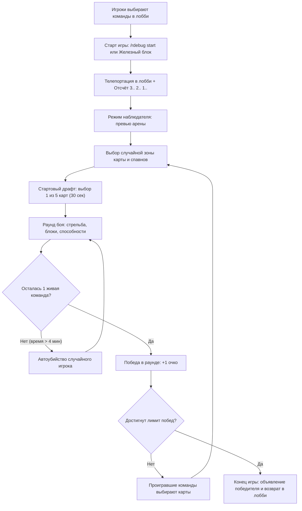

> **Lanquage:** Русский · [English](readme.en.md)
<div align="center">
  

  <h3>RoundsPlugin</h3>

</div>

> Вдохновлено идеей мода [Rounds In Minecraft](https://minecraft-inside.ru/maps/169501-rounds-in-minecraft.html) от автора ifrit.

Minecraft плагин соревновательной мини-игры [**ROUNDS**](https://store.steampowered.com/app/1557740/ROUNDS/) для серверов Paper / Purpur. Поддержка игры 2-4 команд, глубокая карточная система со множество карточек улучшений и возможностью создания своих, настраиваемым количеством раундов, система физических интерактивных блоков для быстрой настройки карт, механика выбора карт для проигравших, автоубийство при затяжных раундах, режим фриплея и поддержка [**TAB**](https://www.curseforge.com/minecraft/mc-mods/tab) / [**PlaceholderAPI**](https://modrinth.com/mod/placeholderapi).


## Системные требования

- **Сервер на paper/purpur с версией майнкрафт 1.20.4 - 26.3**
- **Java:** 17+
- [**PlaceholderAPI**](https://modrinth.com/mod/placeholderapi) и [**TAB**](https://www.curseforge.com/minecraft/mc-mods/tab) (необязательно; плагин и сам по себе способен отображать основные данные, если вы захотите выполнить более детальную настройку)


## Установка

1. Возьмите jar под версию вашего сервера и поместите его в папку "plugins/" сервера.
2. Перезапустите сервер (или используйте PlugMan / перезагрузку) для генерации файлов конфигурации.
3. При необходимости настройте `plugins/Rounds/config.yml`.
4. Настройте или добавьте свои карты в `plugins/Rounds/cards/custom/`.
5. Войдите на сервер с правами администратора (`rounds.admin` или OP), выполните `/rdebug giveblocks` и расставьте интерактивные блоки в мире.


## Возможности

- **Командный бой (до 4 команд):** Синие, Красные, Жёлтые и Зелёные команды.
- **Особое оружие (Пушка):**
  - **ЛКМ:** Стрельба пулями с расчётом физики, разброса, рикошетов и эффектов.
  - **ПКМ:** Блокировка щитом (отражение урона, активация защитных и атакующих карточных эффектов).
  - **Автоматическая и ручная перезарядка:** При исчерпании патронов в обойме или при нажатии клавиши Q (выброс предмета) оружие начинает перезарядку с визуальным прогресс-баром в Action Bar (как в оригинальной игре ROUNDS).
- **Карточная система и способности:**
  - **3D сцена драфта карт в мире (In-World 3D Card Selection Scene):** Вместо плоского GUI-инвентаря перед игроком в воздухе открывается трехмерная полукруглая витрина стендов Text Display. Карты визуализированы своими реальными графическими текстурами через встроенный растровый шрифт: каждая вариация редкости получает собственный глиф и текстуру. Текст названия и описания нанесен непосредственно на текстуры карт, а прямо над каждой карточкой сияют звёзды редкости (от 1 до 5 звёзд по рангу: Common - 1, Uncommon - 2, Rare - 3, Epic - 4, Legendary - 5). Игрок подходит к карточкам пешком на своих ногах (до 2.0м вперед) для детального рассмотрения; на время выбора зона драфта защищена клиентским полом из барьеров и невидимым защитным периметром, исключающим падения с обрывов или на батуты. Для карт Epic и Legendary отображаются эффекты пламени, выбор сопровождается анимацией карусели, а при истечении таймера срабатывает автоматический выбор случайной карты без кика с сервера.
  - **Официальный кросс-версионный ресурспак (Rounds-ResourcePack.zip, -RU.zip, -EN.zip):**
    - Доступны раздельные мультиязычные ресурспаки с текстами на самих картах: `Rounds-ResourcePack-RU.zip`, `Rounds-ResourcePack-EN.zip` и стандартный `Rounds-ResourcePack.zip` (исходные текстуры в `test-servers/original_mod/cards/ru` и `en`).
    - 236 растровых текстур карт (по одной на каждую вариацию редкости) в стандартном разрешении 160x250 (исходный размер арта, без ресайзинга), встроенных в шрифт `rounds:default` (символы `0xE000 + familyId*10 + индекс редкости`). Каждая вариация получает собственную текстуру по ключу `art` внутри `variations` (например, `art: card5-common`). Текст нанесен с контрастной тенью без перекрывающих центральный арт плашек (`tools/generate_card_textures.py`), значения плейсхолдеров `{0}` подставляются из списка `values` вариации.
    - Динамический саундтрек раундов: потоковые музыкальные композиции `music1` .. `music4`, воспроизводимые во время боя.
    - Звуковые эффекты боевых действий: звук идеального блока щитом (`block.ogg`) и звук распила пилой (`saw.ogg`).
    - Автоматическое заглушение ванильной фоновой музыки Майнкрафта (32 звуковых события в `assets/minecraft/sounds.json`), исключающее наложение звуков.
    - Универсальная схема `pack.mcmeta`, гарантирующая работу без ошибок совместимости на клиентах и серверах от 1.20.4 до 26.3 (`pack_format: 22`, `supported_formats: [22, 99]`, `min_format: 22`, `max_format: 99`).
    - Кроссплатформенная сборка ресурспаков через Gradle (`./gradlew buildResourcePacks -PdeployDesktop -PdeployInstances`) и скрипт `build-cardpack.ps1` с авто-деплоем на рабочий стол и в инстансы ATLauncher.
  - **Новые карты и боевые механики:**
    - **Decay (Распад):** Буферизует весь получаемый игроком урон и распределяет его постепенным списанием равными долями в течение 4 секунд (смягчает взрывной урон и ваншоты). Доступны 4 вариации (3, 4, 5, 6 секунд) с аддитивным стаканием.
    - **Echo (Эхо):** При блокировании щитом через 1 секунду (20 тиков) автоматически генерирует второй повторный импульс блокирования без дополнительного расхода зарядов щита.
    - **Demonic Pact:** Расход 10% от текущего HP за каждый выстрел с защитой от самоубийства (остается минимум 1 HP), нулевая задержка между выстрелами, +9 пуль в залпе, +9 патронов в обойме.
    - **Scavenger:** Успешное попадание пулей во врага мгновенно возвращает патроны в обойму стрелка (`ammo-per-hit`) и прерывает активную перезарядку.
    - **Thruster:** Реактивная отдача оружия, толкающая стрелка назад в противоположную сторону вектора взгляда при каждом выстреле.
    - **Динамический масштаб игрока (Player Scaling):** На серверах Paper/Purpur 1.20.5+ / 1.21+ физический размер модели и хитбокса игрока масштабируется через нативный атрибут `Attribute.GENERIC_SCALE`: карты на здоровье и массу (Huge, Tank, Grow) увеличивают модель (до 1.3x-1.8x), а карты на маневренность (Evasion, Sneaky) делают силуэт компактнее.
  - 5 уровней редкости карт с настраиваемыми весами и поддержка вариативности.
  - Карточная компенсация: проигравшая команда получает выбор карты между раундами.
  - Настраиваемый таймер выбора карт (`/rdebug cardchoicetime <sec>`) со звуковым предупреждением на последних 5 секундах, звуком наковальни на последней секунде и автовыбором карты при таймауте.
  - Интерактивный GUI инвентаря карт для игроков (`/rdebug cards show`) и колесо ротации карт (Wheel).
- **Быстрая настройка через блоки:** Специальные интерактивные блоки входа в команды, лобби, зон карт, спавнов, батутов и зон подъёма.
- **Встроенные ИИ-боты (Fast NMS Fake Players с 10 уровнями сложности):** Нативные боевые боты для одиночной игры и тренировок (`/rdebug bot spawn [имя] [команда] [1..10]`, `/rbot`).
  - **Динамическая сложность (Уровни 1..10):** Каждому боту случайным образом присваивается уровень 1..10, который автоматически перевыбирается в начале каждого раунда (`factor = level / 10.0`).
  - **Боевые архетипы (Playstyles):** Каждый раунд бот выбирает один из 4 уникальных стилей игры: `AGGRESSIVE_FLANKER` (фланговые обходы, ближний бой, уклонения в прыжке), `TACTICAL_SNIPER` (контроль дальней дистанции 16-24м, отступление при сближении), `DEFENSIVE_TURTLE` (активный блок щитом, отступление при перезарядке обоймы и низком HP), `ERRATIC_BRAWLER` (джокинг каждые 26-46 тиков, тактические уклонения в перестрелках).
  - **Честное зрение и преследование:** Зрение ограничено конусом обзора 140°, дальностью 60 блоков, слухом шагов до 2.5м и проверкой прямой видимости (Line-of-Sight). Шанс преследования цели: Уровни 1–2 (69%), 3–4 (82.8%), 5–7 (96.6%), 8–10 (100%). Тайм-аут преследования цели при потере обзора составляет 120 тиков (6 секунд).
  - **Человеческая физика и реакция на огонь:** Плавная инерция перемещения с разгоном и торможением, естественная доводка прицела без 1-тиковых снапов. При получении урона боты плавно разворачиваются к стрелку с задержкой реакции (150–350 мс) без 0-тикового телепорта взгляда. Точность определения угла масштабируется по уровню: от погрешности ±45° на 1-м уровне до снайперских ±4.5° на 10-м уровне.
  - **Честное парирование батутов (Jump Pad Parry):** Боты уровня 5 и выше с шансом 50% прогнозируют касание батута за 10–20 тиков до приземления или наступания и нажимают блок щитом. При успешном блоке урон 20% полностью парируется (0 урона), воспроизводится звук парирования щитом, и бот подбрасывается в воздух. Никаких читерских сбросов кулдауна — бот использует только стандартную перезарядку щита (`canBlock()`).
  - **Навигация, преодоление ступеней и выход из тупиков (Anti-Stacking & Red Zones):** Защита от стакинга сбрасывает ботов, если они оказываются на голове друг друга, и не даёт запрыгивать на игроков как на ступени. Алгоритм распознавания ступенек из блоков (`isBlockStaircase`) корректно классифицирует блочные подъемы на +30% эффективнее, поддерживает инерцию во время прыжка и устраняет ложные откаты назад при попытке зайти на ступеньки или паркур. В замкнутых комнатах (от 1x1x1 до 5x5) боты ищут блочные лестницы и паркур-подъемы наверх, либо определяют тупики, помечают их как красные зоны на 60 секунд (`RedZone`) и не возвращаются при патрулировании (вход разрешен только при активной погоне за врагом; выход изнутри всегда открыт). В тупиках 1x1x1 и при встрече стен боты мгновенно поворачиваются к открытому выходу (до 45°/тик) и глушат поступательный шаг вперед, исключая залипание в углах и медленное разглядывание стен (`isInsideCorner`).
  - **Укрытия и засады:** При здоровье <= 20% боты ищут укрытия радиусом 4-6.5 блоков, защищённые от прямой видимости стрелка. За углами боты организуют тактические засады, направляя прицел в открытый коридор и предварительно поднимая щит.
  - **Умное использование батутов и баллистика полета:** Намеренный выбор батутов заблокирован в первые 3–15 секунд раунда (в среднем 5с). При взлете батут дает естественный импульс вперед. В падении и воздухе боты сканируют безопасные твердые платформы внизу и подруливают к ним.
  - **Высокая производительность и масштабируемость (192+ и до 500 ботов):** Предвычисленная матрица боевых характеристик `CombatProfile` (O(1)), навигационная сетка `ArenaNavMesh`, двухэтапная фильтрация целей (FOV и дистанция до лучевой трассировки, отсекающая 99% raycast-проверок), адаптивная 4-уровневая LOD-система (до 5 TPS для далеких ботов при массовых спавнах без задержек физики), O(1) пакетная синхронизация скорборда команд и исключение ботов из хранения скорбордов гарантируют стабильные 20 TPS без фризов даже на слабых серверах (3 ядра / 4 ГБ ОЗУ). Лимит разового спавна расширен до 500 ботов.
  - **Учет установленных блоков команд на карте:** При спавне боты автоматически распределяются только по тем командам, чьи блоки установлены на арене/в лобби.
  - **Синергия способностей карт и раш с пилой (Saw Rush):** С картой пилы бот при блоке совершает агрессивный спринт в упор к врагу (< 2.8м, скорость 0.46). В бою применяются способности карт: Implode (стягивание), Silence (заглушка способностей врага), EMP (замедление), Overpower, BombOnBlock, Teleport, Heal, Shockwave, TacticalReload и др. Эффект подсветки врагов от карты «Марк был хороший» ограничен 10 секундами при выходе из радиуса действия, а активные эффекты зелий у ботов корректно истекают со временем.
  - **Автоматический деспавн и полная очистка памяти:** При остановке игры (`/rdebug stop`, `/rounds stop`), удалении ботов или перезагрузке все боты удаляются с сервера, разрываются ссылки во всех менеджерах, утилизируются NMS-сущности и немедленно освобождается оперативная память через вызов `System.gc()`.
  - **Подсветка и титры раунда для спектраторов:** Для наблюдателей все игроки подсвечены командным контуром свечения (невидимым для бойцов в выживании). Спектраторам без команды отображается нейтральный командный титр победы.
- **Боевая отдача при попадании (Combat Hit Feedback):**
  - При попадании по противнику его 3D-модель окрашивается в ярко-красный цвет с анимацией получения урона (`playHurtAnimation`) и отклонением от вектора выстрела.
  - При получении урона игроком камера плавно наклоняется в сторону источника атаки, а по краям экрана активируется плавная красная виньетка ранения (`WorldBorder` warning).
- **Командная видимость никнеймов и индикация сердец:**
  - Формат никнеймов: `<число> HP <Ник>` для игроков и `<число> HP <Ник> [L<уровень>]` для ботов.
  - Во время боя никнеймы противников скрыты (видны только союзники по команде). Наблюдатели видят никнеймы всех игроков.
  - Пинг каждого игрока в TAB окрашивается в цвет его команды (`%rounds_ping%` для форматированного отображения, `%rounds_ping_raw%` для числовых значений). В TAB числовой счетчик защищен от некорректных цветовых кодов.
- **Интеграция и встроенный скорборд:**
  - Встроенный скорборд включён по умолчанию при отсутствии плагина TAB и автоматически отключается при наличии активного TAB во избежание конфликтов; при отключении в `config.yml` не отображается вовсе.
  - Каждые 5 секунд автоматически переключается между экраном счёта матча (победы команд) и экраном характеристик игрока (HP, урон, карты, пули, патроны).
  - Работает полностью автономно без обязательной установки PlaceholderAPI благодаря прямому вычислению параметров и двойной буферизации без мерцания (zero flicker).
  - Полная поддержка [**PlaceholderAPI**](https://modrinth.com/mod/placeholderapi) и [**TAB**](https://www.curseforge.com/minecraft/mc-mods/tab) при их наличии.
- **Встроенный HUD-оверлей счёта матча («квадратики» раундов):**
  - Полностью автономный встроенный оверлей счета раундов (`HudEngineCustomRealisation`) без внешних зависимостей.
  - 100% 1:1 совместимость со всеми существующими ресурспаками: используются нативные Adventure BossBar с прозрачной текстурой (`PINK`), шрифтовые глифы (`hudengine:hud`) и динамическое позиционирование отрицательными пробелами (`hudengine:space`).
  - Плавное динамическое обновление пустых ячеек раундов и побед команд в реальном времени.
  - Динамическое количество строк: оверлей отображает только активные команды (2 команды = 2 строки, 3 = 3, 4 = 4), новые строки аккуратно добавляются снизу при подключении команд.
- **Мультиязычность:** Полная локализация интерфейса и карт через систему языковых пакетов (`lang/*.txt`).


## Быстрый старт и настройка арены

### 1. Получение блоков настройки

Выполните команду:
```
/rdebug giveblocks
```
Вам будут выданы стаки всех специальных блоков, а режим игры автоматически переключится в **Творческий (Creative)**.

### 2. Таблица специальных блоков

#### Блоки выбора команды (Лобби)
Игроки наступают на соответствующий блок шерсти в лобби, чтобы вступить в команду.

| Блок | Предмет / Материал | Назначение |
|------|--------------------|------------|
| **Вход за Синюю команду** | Светло-синяя шерсть (`LIGHT_BLUE_WOOL`) | Вступление в синюю команду |
| **Вход за Красную команду** | Красная шерсть (`RED_WOOL`) | Вступление в красную команду |
| **Вход за Жёлтую команду** | Жёлтая шерсть (`YELLOW_WOOL`) | Вступление в жёлтую команду |
| **Вход за Зелёную команду** | Лаймовая шерсть (`LIME_WOOL`) | Вступление в зелёную команду |
| **Выход из команды (Зритель)** | Белая шерсть (`WHITE_WOOL`) | Выход из всех команд в статус наблюдателя |

#### Блоки карты, лобби и спавнов

| Блок | Предмет / Материал | Назначение |
|------|--------------------|------------|
| **Блок лобби** | Изумрудный блок (`EMERALD_BLOCK`) | Центр лобби. Точка возврата игроков до/после матча. На карте может быть только 1 активный блок лобби (установка нового перемещает точку). Также можно задать через `/rdebug setlobby`. |
| **Блок зоны карты 50x50** | Алмазный блок (`DIAMOND_BLOCK`) | Центр игровой зоны размером 50x50 блоков по X/Z. |
| **Блок зоны карты 100x100** | Изумрудный блок (`EMERALD_BLOCK`) | Центр игровой зоны размером 100x100 блоков по X/Z. |
| **Блок спавна** | Обсидиан (`OBSIDIAN`) | Точка появления команды внутри зоны карты. |
| **Блок прыжка (Батут)** | Угольный блок (`COAL_BLOCK`) | При падении/наступании отнимает 20% здоровья (парируется щитом) и подбрасывает игрока высоко вверх. |
| **Блок подъёма (Лифт)** | Пурпурная глазурованная керамика (`PURPLE_GLAZED_TERRACOTTA`) | При наступании плавно поднимает игрока вверх в течение заданного времени. |

#### Блоки управления игрой

| Блок | Предмет / Материал | Назначение |
|------|--------------------|------------|
| **Блок старта игры** | Железный блок (`IRON_BLOCK`) | Запуск матча при наступании (для администраторов или всех при включённом фриплее). |
| **Блок завершения игры** | Блок красного камня (`REDSTONE_BLOCK`) | Принудительная остановка матча и сброс состояния. |

### 3. Пошаговая настройка арены

1. **Лобби:** Поставьте **Блок лобби** в зоне ожидания и разместите блоки шерсти для выбора команд.
2. **Зоны карты:** Поставьте один или несколько **Блоков карты** (50x50 или 100x100) в центрах игровых локаций. В каждом раунде плагин выбирает случайную зону.
3. **Спавны команд:** Внутри радиуса каждой зоны карты поставьте **Блоки спавна** (обсидиан) — точки, где будут появляться команды в начале раунда.
4. **Интерактивные элементы (по желанию):** Разместите блоки прыжка или зоны подъёма вручную либо выделите область командами `/rdebug jumppos1` / `jumppos2` / `jumpset` и `/rdebug uppos1` / `uppos2` / `upset`.


## Игровой процесс



1. **Подготовка:** Игроки встают на шерсть своей команды.
2. **Запуск:** Администратор вводит `/rdebug start` или наступает на Железный блок.
3. **Отсчёт:** Запускается 3-секундный таймер в чате. Игроки переходят в режим наблюдателя для осмотра локации.
4. **Стартовый выбор карт:** Игрокам открывается меню из 5 случайных карт. На выбор дается 30 секунд (настраивается командой `/rdebug cardchoicetime <sec>`). Во время фазы выбора все игроки и боты неподвижны и бессмертны.
5. **Бой:** Игроки получают пушку, переходят в режим выживания и сражаются на выбранной арене.
6. **Завершение раунда:** Команда последнего выжившего получает очко раунда.
7. **Фаза улучшения:** Игроки проигравших команд получают новое меню выбора карт для усиления перед следующим раундом (все участники остаются неподвижными и бессмертными до завершения выбора).
8. **Победа в матче:** Первая команда, набравшая установленное количество побед (по умолчанию 5), побеждает в матче, после чего все возвращаются в лобби.


## Конфигурация (`config.yml`)

```yaml
# Языковой пакет из папки plugins/Rounds/lang/ (без расширения .txt)
language: EN_en

# Базовые характеристики игроков (сбрасываются каждый раунд)
defaults:
  damage: 3.0            # Базовый урон за пулю
  attack-speed: 20       # Кулдаун между выстрелами в тиках (20 тиков = 1 сек, меньше = быстрее)
  attack-speed-modifier: 0
  attack-range: 0
  ammo: 3                # Начальное количество патронов в обойме
  max-ammo: 3            # Максимальный размер обоймы
  bullets: 1             # Количество пуль за один выстрел (1 = обычный выстрел, >1 = дробовик)
  hp: 20                 # Начальный запас здоровья (максимум до 2048)
  bullet-speed: 1.0      # Множитель скорости полёта пуль
  reload-speed: 0        # Бонус скорости перезарядки

# Параметры матча и раундов
game:
  default-rounds: 5      # Количество побед для общего выигрыша по умолчанию
  countdown-seconds: 3   # Время обратного отсчёта до старта раунда в секундах
  round-time-seconds: 180 # Время основного раунда в секундах до внезапной смерти (по умолчанию 180 сек = 3 мин)
  card-choice-time: 30   # Время на выбор карты в секундах (минимум 10 сек)
  card-selection-time: 200 # Время отображения GUI выбора карт (в тиках)
  respawn-delay: 5       # Задержка респавна в тиках
  auto-death:
    enabled: true        # Включение автоубийства при затягивании раунда
    delay-seconds: 240   # Задержка до первого события автоубийства (240 сек = 4 мин)
    interval-seconds: 60 # Интервал между последующими предупреждениями и смертями
    bossbar: true        # Отображение таймера раунда и внезапной смерти в боссбаре

# Список активных команд
teams:
  enabled:
    - BLUE
    - RED
    - YELLOW
    - GREEN

# Настройки оружия и щита
gun:
  base-cooldown: 20      # Базовый кулдаун выстрела

shield:
  duration-ticks: 20     # Длительность действия щита в тиках (20 тиков = 1 сек)
  cooldown-ms: 10000     # Кулдаун щита в миллисекундах (10000 = 10 сек)
  no-party-cooldown-ms: 30000 # Кулдаун карты No Party в миллисекундах
  no-party-radius: 5.0   # Радиус действия карты No Party в блоках

# Карточная система
cards:
  selection-count: 5     # Количество карт, предлагаемых на выбор
  weighted-rarity: true  # Учёт весов редкости при генерации карт

# Параметры ИИ-ботов
bots:
  bulk-limit: 500        # Максимальное количество ботов при массовом спавне
  vision:
    fov-degrees: 140.0   # Угол конуса зрения в градусах
    max-distance: 60.0   # Максимальная дистанция зрения в блоках
    proximity-hearing: 2.5 # Радиус слышимости шагов в блоках
  jump-pad-parry:
    chance: 0.50         # Шанс парирования батута щитом (50%)
    min-level: 5         # Минимальный уровень бота для парирования (уровень 5+)

# Интерактивные блоки арены
jump-block:
  damage-percent: 20.0   # Процент от максимального HP, отнимаемый при прыжке (парируется щитом)
  launch-height: 10.0    # Высота подбрасывания в блоках

up-block:
  lift-speed: 0.3        # Скорость вертикального подъёма
  duration-ticks: 40     # Длительность подъёма в тиках (40 тиков = 2 сек)

# Автоматическое управление игровыми правилами мира
game-rules:
  enabled: true
  instant-respawn: true       # Мгновенный респавн без экрана смерти
  keep-inventory: true        # Сохранение инвентаря
  freeze-time: true           # Фиксация дневного времени
  disable-weather: true       # Отключение дождя и грозы
  disable-mob-spawning: true  # Отключение спавна мобов

# Окрашивание ников игроков в табе и над головой в цвет команды
color-nicknames: true

# Встроенный Scoreboard (включен по умолчанию, отключается при установке плагина TAB)
builtin-scoreboard:
  enabled: true
  title: "&6&lROUNDS"
  stats-title: "&b&lМои статы"

# Разрешить игрокам без прав OP/admin запускать безопасные команды тренировки и матча
# Разблокируются ключи для команды: /rdebug (а именно: start, stop, rounds, givegun, wheel, bossbar, bot), а также доступна становится команда /rbot
freeplay:
  enabled: false
```


## Карточная система

Карты хранятся в формате отдельных YAML-файлов:
- `plugins/Rounds/cards/original/` — стандартные встроенные карты.
- `plugins/Rounds/cards/custom/` — пользовательские карты.

### Пример обычной карты (`burst.yml`)
```yaml
id: 8
name:
  ru: "&aОчередь"
  en: "&aBurst"
description:
  ru: "+2 пули, +3 патрона, -60% урона, +10% к времени перезарядки"
  en: "+2 Bullets, +3 Ammo, -60% DMG, +10% Reload time"
material: ARROW
enabled: true
variations:
  - rarity: COMMON
    effects:
      bullets: 2
      ammo: 3
      damage: -0.6
      reload: 1
```

### Пример карты с вариативностью (`combine.yml`)
```yaml
id: 13
name:
  ru: "&4Объединение"
  en: "&4Combine"
description:
  ru: "+{0} урона, -{1} патрона, +{2} к перезарядке"
  en: "+{0} DMG, -{1} Ammo, +{2} Reload time"
material: REDSTONE
enabled: true
variations:
  - rarity: COMMON
    values: ["50%", "1", "5%"]
    effects:
      damage: 0.5
      ammo: -1
      reload: 0.5
  - rarity: UNCOMMON
    values: ["75%", "2", "8%"]
    effects:
      damage: 0.75
      ammo: -2
      reload: 0.8
  - rarity: RARE
    values: ["100%", "2", "10%"]
    effects:
      damage: 1.0
      ammo: -2
      reload: 1.0
  - rarity: EPIC
    values: ["125%", "3", "13%"]
    effects:
      damage: 1.25
      ammo: -3
      reload: 1.3
```

### Ключи эффектов карт

| Ключ в YAML | Описание эффекта |
|-------------|------------------|
| `damage` | Множитель урона (+0.5 = +50% урона, -0.6 = -60%) |
| `attack-speed` | Скорость атаки (изменяет кулдаун между выстрелами) |
| `attack-speed-reload` / `reload` | Дополнительная задержка перезарядки |
| `attack-range` | Дополнительный радиус атаки |
| `bullets` | Количество дополнительных пуль за выстрел |
| `ammo` | Количество патронов в обойме и макс. вместимость |
| `bullet-speed` | Скорость полёта пуль |
| `bounce` | Количество рикошетов пули от стен и блоков |
| `target-bounce` | Рикошет пули в ближайшего врага |
| `damage-per-bounce` | Бонусный урон за каждый совершенный рикошет |
| `hp` | Множитель максимального здоровья (+0.5 = +50% HP) |
| `hp-cost` | Расход % от макс. здоровья при каждом выстреле |
| `cold` / `cold-level` | Шанс и уровень эффекта замедления/обморожения цели |
| `poison` / `poison-level` | Шанс и уровень отравления |
| `toxic-cloud` | Появление ядовитого облака при попадании |
| `parazit` / `parazit-level` | Шанс и уровень наложения эффекта иссушения |
| `leech` | Вампиризм (лечение стрелка на % от нанесённого урона) |
| `homing` | Сила самонаведения пуль на противников |
| `homing-on-block` | Самонаведение пуль на N секунд после блокировки щитом |
| `empower` / `empower-charge` | Усиление урона следующего выстрела после блока |
| `dark-strength` | Постоянный бонус к урону (+0.5 урона за стак) |
| `big-bullet` | Большая пуля: +70% к размеру хитбокса попадания, +30% к времени перезарядки |
| `bomb-bullet` | Спавн взрыва/бомбы в точке попадания пули |
| `bomb-on-block` | Спавн бомб вокруг игрока при активации щита |
| `explode-bullets` | Взрывной AoE-урон вокруг места попадания |
| `shield` | Наличие и базовые параметры щита |
| `shield-charge` | Дополнительные заряды щита (парирования) |
| `double-block` | Двойной заряд блокировки |
| `shields-up` | Автоматическая активация щита при опустошении обоймы |
| `block-cd` / `shield-cooldown` | Изменение кулдауна блокировки щитом |
| `reload-speed` | Бонус к скорости перезарядки (до 0.95) |
| `tactical-reload` | Мгновенная перезарядка оружия при блокировке щитом |
| `auto-reload` | Пассивная автоперезарядка патронов со временем |
| `truster` / `truster-lvl` | Увеличенная сила отбрасывания врагов пулями |
| `jump-height` | Увеличение высоты прыжка игрока |
| `grow` | Увеличение запаса здоровья и физического размера модели |
| `speed` / `speed-boost` | Скорость перемещения игрока |
| `stun` | Оглушение противника при попадании |
| `heal` | Периодическая регенерация здоровья |
| `saw` | Пила: огненное кольцо урона вокруг игрока при блоке |
| `shockwave` | Ударная волна: сильное отбрасывание врагов вокруг при блоке |
| `implode` | Притягивание врагов к игроку при активации блока |
| `silence` | Безмолвие: запрет стрельбы и щита врагам вокруг на время |
| `silence-aura` | Постоянная аура безмолвия вокруг игрока |
| `sneaky` | Скрытность / незаметность |
| `emp` | ЭМП: сильное замедление врагов вокруг при блоке |
| `overpower` | Сокрушение: урон врагам вокруг в % от текущего HP при блоке |
| `refresh` | Сброс кулдауна щита и мгновенное пополнение патронов |
| `radiance` / `highlight` | Подсветка силуэтов врагов эффектом свечения |
| `lifesteal-aura` | Аура высасывания здоровья у врагов поблизости |
| `phoenix` | Феникс: автоматическое воскрешение при получении смертельного урона |
| `abyssal` | Бездна: призыв фантома-помощника, если стоять неподвижно 10 секунд |
| `drill` | Буровые пули: пробивают стены и летят сквозь препятствия |
| `teleport` | Телепортация вперёд в направлении взгляда при блокировке |
| `ammo-per-hit` | Восстановление патронов при успешном попадании |
| `hp-boost-on-hit` | Увеличение макс. запаса HP при попадании |
| `pristine-perseverance` | Бонус к здоровью при полном запасе HP |
| `blood-furry` | Ярость: бафф характеристик при получении урона |
| `executioner` | Палач: добивающий урон по целям с низким HP |
| `storm-caller` | Призыв молний при попадании |
| `evasion` | Шанс уклонения от входящего урона |
| `chameleon` | Невидимость при неподвижности |
| `snowball` | Эффект снежка: накапливаемые бонусы за серии побед |
| `skyfall` | Удар по площади при приземлении с высоты без урона от падения |
| `berserk` | Увеличение параметров по мере снижения здоровья |
| `overheat` | Перегрев: стрельба без патронов за счёт собственного здоровья |
| `second-wind` | Второе дыхание: спасение от смерти с 1 HP и неуязвимостью |
| `spikes` | Шипы: возврат урона атакующему |
| `bullet-rain` | Дождь пуль и расширение обоймы |
| `frost-armor` | Ледяная броня: замедление атакующих врагов |
| `no-party` | Блокировка щита и перезарядки ближайшим противникам |
| `blood-cartridge` | «Почки продам, но выстрелю»: стрельба во время перезарядки за % HP (7..15%), бонус к урону и криты |
| `spite-razorwire` | «А нас-то за что?!»: веер шипов при попадании по вам (4..8 осколков, на эпике — самонаведение и 10% вампиризма) |
| `temporal-recall` | «Бро, я записал откат»: откат на 3 секунды назад при блоке щитом с возвратом HP и патронов (кд 15с, Legendary) |
| `bullet-time` | «Погоди, шнурок развязался»: спасение от смерти / при HP <= 20%, 1с неуязвимости, 5с замедления врагов и их пуль на 85% (Legendary) |
| `decay` | Буферизация урона: распределение входящего урона равными долями на 4 секунды (смягчение ваншотов) |
| `echo` | Повторный импульс блока щитом через 1 секунду без расхода кулдауна щита |
| `thruster` | Реактивная отдача: импульс отталкивания стрелка назад при каждом выстреле |

### Редкости карт и шансы

| Редкость | Цвет | Базовый вес выпадения |
|----------|------|------------------------|
| **COMMON** | Белый (`&f`) | 40 |
| **UNCOMMON** | Зелёный (`&a`) | 30 |
| **RARE** | Голубой (`&b`) | 18 |
| **EPIC** | Светло-фиолетовый (`&d`) | 9 |
| **LEGENDARY** | Золотой (`&6`) | 3 |


## Декларативная система боевых триггеров карт (Data-Driven Cards)

Плагин предоставляет высокопроизводительный декларативный движок боевых триггеров и действий. Он позволяет создавать уникальные геймплейные механики карт через обычные YAML-файлы без написания кода на Java и без необходимости перекомпилировать плагин.

### 1. Автодополнение и валидация через JSON Schema
В корне репозитория и в ресурсах плагина поставляется файл `cards.schema.json`. При указании ссылки на схему в первой строке любого файла карты:
```yaml
# yaml-language-server: $schema=../../cards.schema.json
```
Редакторы кода (IntelliJ IDEA, Visual Studio Code) автоматически обеспечивают:
- Интерактивное автодополнение названий всех характеристик, триггеров и параметров.
- Всплывающие подсказки с описанием каждого поля прямо при наведении курсора.
- Мгновенную валидацию типов данных (числа, строки, массивы) и подсветку ошибок.

### 2. Доступные боевые триггеры (`on:`)
Диспетчеризация триггеров выполняется напрямую через предварительно скомпилированный реестр без строкового парсинга и без создания временных объектов во время боевого тика:
- `ON_SHOOT` — срабатывает в момент произведения выстрела игроком.
- `ON_BULLET_HIT` — срабатывает при успешном попадании пули во вражескую сущность.
- `ON_DAMAGE_TAKEN` — срабатывает при получении игроком любого входящего урона.
- `ON_SHIELD_BLOCK` — срабатывает при успешном парировании атаки или снаряда щитом.
- `ON_RELOAD` — срабатывает в момент успешного завершения перезарядки оружия.

### 3. Доступные действия (`action:`)
Каждое действие выполняется мгновенно с заданными параметрами:
- `RESTORE_AMMO` — пополнение боезапаса в обойме стрелка на указанное число патронов (`value: N`).
- `HEAL` — восстановление здоровья игроку (`value: N` HP).
- `DAMAGE_VICTIM` — нанесение чистого урона цели (`value: N` урона).
- `PUSH_SHOOTER` — придание стрелку вектора отдачи в направлении взгляда (`value: N` множитель силы).
- `PUSH_VICTIM` — отталкивание цели от стрелка (`value: N` множитель силы).
- `PLAY_SOUND` — воспроизведение звука игроку (`param`: строковый идентификатор звука, `value`: питч).
- `SPAWN_PARTICLE` — спавн визуальных частиц (`param`: имя частицы Bukkit Particle, `value`: количество).
- `APPLY_POTION` — наложение эффекта зелья на цель (`param`: тип эффекта, `value`: длительность в секундах).

### Пример продвинутой карты с триггерами (`vampirism.yml`)
```yaml
# yaml-language-server: $schema=../../cards.schema.json
id: 500
name:
  ru: "Вампиризм"
  en: "Vampirism"
description:
  ru: "Попадание пулей по врагу исцеляет вас на 2 HP и восполняет 1 патрон"
  en: "Hitting an enemy with a bullet restores 2 HP and refunds 1 ammo"
rarity: RARE
material: REDSTONE
enabled: true
art: card_500.png
effects:
  bullets: 0
triggers:
  - on: ON_BULLET_HIT
    action: HEAL
    value: 2.0
  - on: ON_BULLET_HIT
    action: RESTORE_AMMO
    value: 1.0
  - on: ON_BULLET_HIT
    action: PLAY_SOUND
    value: 1.2
    param: "entity.player.levelup"
  - on: ON_BULLET_HIT
    action: SPAWN_PARTICLE
    value: 6
    param: "HEART"
```


## Кроссплатформенная экосистема ресурспаков и генерация ассетов

Для плагина реализована полноценная автономная инфраструктура генерации графических и аудио-ресурспаков, работающая независимо от операционной системы.

### 1. Мультиязычные ресурспаки с запеченным текстом
Официальный ресурспак плагина основан на оригинальном ресурспаке от автора **ifrit**, с последующими изменениями: переработкой структуры, добавлением вариаций текстур, адаптивной локализацией (RU/EN), квантованием палитры и оптимизацией от **Mr712**.

Текст названия и описания наносится непосредственно на текстуры карточек. Чтобы поддерживать несколько языков, формируются отдельные ресурспаки:
- `Rounds-ResourcePack-RU.zip` — текстуры с запеченным русским переводом ([Скачать на Google Диске](https://drive.google.com/file/d/1iIUzIZvINLABf8wC-efULsBi0QwQq4Uk/view?usp=sharing)).
- `Rounds-ResourcePack-EN.zip` — текстуры с запеченным английским переводом ([Скачать на Google Диске](https://drive.google.com/file/d/1zbkjWkx8JeeoT1vGx7mAX81mnR_lltHK/view?usp=sharing)).
- `Rounds-ResourcePack.zip` — базовый пакет с оригинальными чистыми карточками (без текста) для добавления своих переводов и кастомного текста сторонними авторами ([Скачать версию для разработчиков на Google Диске](https://drive.google.com/file/d/167EDDr76AEcPsOsyQsCadylcY-O1YPyQ/view?usp=sharing)).

Кодовые позиции растровых глифов шрифта (`0xE000` + `familyId`) идентичны во всех пакетах. Игрок просто выбирает ресурспак своего языка в настройках Minecraft без необходимости менять что-либо на сервере.

#### Автозагрузка ресурспака на сервере (server.properties)
Чтобы игроки автоматически скачивали мой уже готовый русскоязычный ресурспак при подключении к серверу, укажите следующие параметры в файле `server.properties`:

```properties
resource-pack=https://drive.google.com/uc?export=download&id=1iIUzIZvINLABf8wC-efULsBi0QwQq4Uk
resource-pack-id=276093b4-f5ee-3eca-8dba-2448a11ee78a
resource-pack-prompt={"text"\:"Ресурспак ROUNDS","color"\:"gold"}
resource-pack-sha1=3fd4def2be6a904b1db6160f0982ae39905511e7
```

Контрольные суммы SHA-1 актуальных пакетов:
- `Rounds-ResourcePack-RU.zip`: `3fd4def2be6a904b1db6160f0982ae39905511e7`
- `Rounds-ResourcePack-EN.zip`: `d41d0776031c7d845197dfd6bf96a71023476243`
- `Rounds-ResourcePack.zip`: `4a002a3aa773f62d7302444c0b90505bea009d36`

### 2. Полная архитектура и стандарты ресурспака

Ресурспак плагина Rounds объединяет четыре ключевые подсистемы, работающие в ванильном клиенте:

1. **3D Карточки способностей драфта (`rounds:default`):**
   - Текстуры карт хранятся в `assets/rounds/textures/font/` с разрешением 160x250 пикселей. Для карт с вариациями создаются файлы вида `card<id>-<rarity>.png`, для карт без вариаций — `card_<id>.png`.
   - Конфигурация шрифта `assets/rounds/font/default.json` связывает текстуры с символами диапазона Private Use Area (`0xE000` + `familyId * 10 + rarityIndex`), с высотой `height: 88` и подъёмом `ascent: 87`.

2. **Модели оружия и звуковое сопровождение:**
   - 3D-модель револьвера `assets/rounds/models/item/gun.json` и текстура `assets/rounds/textures/item/piton.png`.
   - Подмена модели ванильной палочки для версий 1.20.4-1.21.3 через `assets/minecraft/models/item/stick.json` (предикат `custom_model_data: 1`) и для 1.21.4+ через `assets/minecraft/items/stick.json` (`range_dispatch`).
   - Музыка раундов `music1`..`music4` с флагом `stream: true`, боевые звуки `block.ogg`, `saw.ogg` в `assets/rounds/sounds/` и глушитель 32 ванильных треков через `assets/minecraft/sounds.json`.

3. **Автономный экранный HUD оверлей счёта (Zero-Client-Mod HUD):**
   - **Таблица символов `hud.json` (строго 821 провайдер):**
     - 800 статических символов `0xF5000`..`0xF531F` (сетка 100 раундов для 4 команд).
     - 20 динамических символов матрицы строк $L \times C$ `0xF5400`..`0xF5413` для `HudEngineCustomRealisation`:
       - Линия 0: `ascent = -8400907` (empty), `-8409099` (win)
       - Линия 1: `ascent = -8400919` (empty), `-8409111` (win)
       - Линия 2: `ascent = -8400931` (empty), `-8409123` (win)
       - Линия 3: `ascent = -8400943` (empty), `-8409135` (win)
     - Провайдер типа `space` для отрицательного и положительного позиционирования курсора от `-8192` до `+8192` (`0xF0000`..`0xF4000`), а также `assets/hudengine/font/space.json`.
   - **Скрытие стандартной полосы BossBar:**
     - Текстуры полосы боссбара цвета `PINK` в `assets/minecraft/textures/gui/sprites/boss_bar/pink_background.png` и `pink_progress.png` (только для скрытия подложки оверлея, желтая полоса `yellow_*` таймера раунда не скрывается) обязаны быть прозрачными 1x1 PNG (83 байта). Без них ванильный клиент отрисовывает розовую полосу боссбара под оверлеем.
   - **Вертексные Core Shaders (`DEFAULT_OFFSET 29`):**
     - Вертексный шейдер `rendertype_text.vsh` (Minecraft до 1.21.1) и `text.vsh` (Minecraft 1.21.2+ и Purpur 26.2) в `assets/minecraft/shaders/core/` и во всех 5 оверлеях (`overlay_lightmap`, `overlay_sso`, `overlay_text`, `overlay_ubo150`, `overlay_ubo330`) ОБЯЗАНЫ использовать директиву `#define DEFAULT_OFFSET 29`. Использование значения `10` смещает интерфейс на 19 пикселей вверх к середине экрана.
   - **Версионные оверлеи в `pack.mcmeta`:**
     - Поддержка форматов пакетов от 22 до 99 гарантирует работу шейдеров на современных клиентах без конфликтов версий.

### 3. Инструкция по сборке ресурспака

#### Шаг 1. Запекание текстов карт (при изменении карт или баланса)
Инструмент `tools/generate_card_textures.py` на базе Pillow считывает названия и описания из YAML-файлов карт, форматирует переносы строк и запекает текст на карточки:
```bash
python tools/generate_card_textures.py
```
Готовые ассеты сохраняются в `test-servers/original_mod/cards/ru` и `cards/en`.

#### Шаг 2. Сборка ресурспаков через Gradle (`CardPackBuilder`)
Сборка выполняется на чистом Java-коде (`ZipOutputStream`, `ImageIO`), работает кроссплатформенно на Windows, Linux, macOS и в CI:
```bash
# Стандартная сборка в папку resourcepacks_builds/:
./gradlew buildResourcePacks

# Сборка с автоматическим деплоем на рабочий стол и во все инстансы ATLauncher:
./gradlew buildResourcePacks -PdeployDesktop -PdeployInstances
```
Сборщик упаковывает все текстуры, звуки, модели и автоматически объединяет HUD-ассеты и шейдеры из `tools/assets/HUDEngine.zip`.

## Команды и права

Главная команда плагина — `/rdebug` (также доступны `/rounds` и `/rbot`).

### Общедоступные команды (для всех игроков)

| Команда | Описание |
|---------|----------|
| `/rdebug join` | Присоединиться к игре (в лобби или к идущему матчу: автораспределение в наименьшую команду либо восстановление сохранённой сессии) |
| `/rdebug info` | Информация о плагине, текущем состоянии матча, командах и загруженных картах |
| `/rdebug status` | Показать текущий раунд, статус матча и счёт команд |
| `/rdebug stats show [игрок]` | Показать подробные боевые характеристики игрока (если ник не указан, покажет ваши) |
| `/rdebug cards show [игрок] [страница]` | Открыть просмотр полученных карт игрока |
| `/rdebug statsend [игрок]` | Статистика за прошлый завершённый матч: урон, выстрелы, киллы, смерти |

### Режим фриплея (`freeplay: true`)

Параметр `reeplay.enabled` в `config.yml` или команда `/rdebug freeplay on|off` переключает режим фриплея. При включении фриплея игрокам открываются команды управления матчем и ботами для самостоятельных игр.

| Команда | Параметры | Описание |
|---------|-----------|----------|
| `/rdebug start` | | Запуск игры |
| `/rdebug stop` | | Остановка игры |
| `/rdebug rounds <n>` | `<число>` | Выбор количества побед для выигрыша |
| `/rdebug givegun` | | Получение оружия |
| `/rdebug wheel <on\|off>` | `on/off` | Переключение ротации карт драфта |
| `/rdebug bossbar <on\|off>` | `on/off` | Переключение боссбара матча |
| `/rdebug bot` | | Спавн, настройка и удаление тренировочных ботов |
| `/rbot` | | Полный комплекс управления ботами (`spawn`, `despawn`, `list`, `level`, `strategy` и т.д.) |

### Команды администратора (`rounds.admin`)

| Команда | Параметры | Описание |
|---------|-----------|----------|
| `/rdebug help` | | Вывод структурированной справки по всем командам |
| `/rdebug start` | | Запустить матч (отсчёт -> превью -> выбор карт -> раунд) |
| `/rdebug stop` | | Принудительно остановить игру и вернуть всех в лобби |
| `/rdebug status` | | Показать текущий раунд, статус матча и счёт команд |
| `/rdebug rounds <число>` | `<1..N>` | Установить количество побед для выигрыша |
| `/rdebug cardchoicetime <sec>` | `<>=10>` | Установить время на выбор карты улучшения в секундах (по умолчанию 30) |
| `/rdebug autodeath <on\|off>` | `on/off` | Включить/выключить автоубийство случайного игрока при затяжных раундах (>4 мин) |
| `/rdebug freeplay <on\|off>` | `on/off` | Включить/выключить доступ к базовым командам для игроков |
| `/rdebug giveblocks [игрок]` | `[игрок]` | Выдать стак всех специальных блоков и включить режим Creative |
| `/rdebug setlobby` | | Установить точку лобби на текущую позицию игрока |
| `/rdebug jumppos1` / `jumppos2` | | Установить 1-ю и 2-ю точки для зоны прыжка |
| `/rdebug jumpset` | | Заполнить выделенную область блоками прыжка (`COAL_BLOCK`) |
| `/rdebug uppos1` / `uppos2` | | Установить 1-ю и 2-ю точки для зоны подъёма |
| `/rdebug upset` | | Заполнить выделенную область блоками подъёма (`PURPLE_GLAZED_TERRACOTTA`) |
| `/rdebug cards` | | Открыть тестовое меню выбора из 5 карт |
| `/rdebug cards reload` | | Перезагрузить файлы карт из `cards/original` и `cards/custom` |
| `/rdebug cards add <игрок> <название\|id> [редкость]` | `<игрок> <карта> [редкость]` | Выдать карту игроку (с динамическим выбором редкости или случайной, если не указана) |
| `/rdebug wheel <on\|off>` | `on/off` | Включить/выключить авторотацию карт каждые 6 сек во время выбора |
| `/rdebug givegun [игрок\|@a]` | `[игрок\|@a]` | Выдать пушку себе, указанному игроку или всем игрокам |
| `/rdebug tab <on\|off>` | `on/off` | Включить/выключить встроенный Scoreboard |
| `/rdebug tab name <заголовок>` | `<текст>` | Изменить заголовок встроенного Scoreboard |
| `/rdebug screenindicators <on\|off>` | `on/off` | Переключить оверлей счёта раундов (квадратики). При включении скрывает чат-блоки побед в раундах |
| `/rdebug stats show [игрок]` | `[игрок]` | Показать подробные боевые характеристики игрока (если ник не указан — показывает ваши; открыто всем игрокам) |
| `/rdebug stats add <игрок> <стат> <значение>` | `<игрок> <стат> <значение>` | Установить боевую характеристику игрока в понятных единицах (только админам) |
| `/rdebug statsend [игрок]` | `[игрок]` | Статистика за прошлый матч: урон, выстрелы, киллы, смерти (открыто всем) |
| `/rdebug setteam <ЦВЕТ> [игрок]` | `<BLUE\|RED\|YELLOW\|GREEN>` | Принудительно установить команду игроку |
| `/rdebug setlanguage <язык>` | `<RU_ru\|EN_en...>` | Сменить язык плагина на лету |
| `/rdebug effect <тип> <уровень> <длительность>` | `<тип> <amp> <dur>` | Наложить эффект зелья на себя |
| `/rdebug heal [кол-во]` | `[HP]` | Восстановить здоровье игрока |
| `/rdebug resetstats [игрок]` | `[игрок]` | Сбросить все характеристики, карты и инвентарь себе или указанному игроку |
| `/rdebug draft [игрок]` | `[игрок]` | Открыть тестовое меню выбора из 5 карт игроку или боту |
| `/rdebug placeholders` | | Вывести список всех доступных плейсхолдеров плагина |
| `/rdebug reload` | | Перезагрузить конфигурацию плагина `config.yml` |
| `/rdebug debug start` | | Начать отладочную сессию немедленно |
| `/rdebug debug start <раунд>` | `<1..N>` | Планировать автоматический старт логирования при начале указанного раунда (если раунд текущий и матч идёт — старт немедленно) |
| `/rdebug debug start <раунд> stop <раунд>` | `<1..N> stop <1..N>` | Планировать старт с автостопом: дамп делается в конце указанного отладочного раунда, матч продолжается |
| `/rdebug debug stop [раунд]` | `[1..N]` | Остановить сессию (дамп) и закрыть файл; останавливается только логирование, игра продолжается |
| `/rdebug debug cancel` | | Отменить запланированный старт отладочной сессии |

### Управление боевыми ботами (`/rbot` и `/rdebug bot`)

| Команда | Описание |
|---------|----------|
| `/rdebug bot [имя] [команда] [1..10]` | Заспавнить боевого бота (авто-имя `rbot<1..9999>` и авто-команда если не указаны) |
| `/rdebug bot spawn count <N>` | Заспавнить N ботов (до 500) с авто-именами и балансировкой по установленным на карте блокам команд |
| `/rdebug bot level <имя> [1..10]` | Посмотреть или установить уровень сложности бота (1..10) |
| `/rdebug bot despawn <имя>` | Удалить указанного бота |
| `/rdebug bot despawn count <N>` | Удалить N ботов (приоритетно из команд с наибольшим числом участников) |
| `/rdebug bot despawn all` | Удалить всех активных ботов с сервера |
| `/rbot spawn [имя] [команда] [1..10]` | Спавн бота (авто-имя `rbot<1..9999>` и авто-команда по умолчанию с учетом карты) |
| `/rbot spawn count <N>` | Спавн N ботов (до 500) со случайными именами и балансировкой по установленным на карте блокам команд |
| `/rbot despawn <имя>` | Удалить бота по имени |
| `/rbot despawn count <N>` | Удалить N ботов со случайным выбором, начиная с команд где игроков больше |
| `/rbot despawn all` | Удалить всех ботов |
| `/rbot list` | Список всех активных ботов с их HP и текущим уровнем сложности (Lvl: 1..10) |
| `/rbot <имя> level [1..10]` | Посмотреть или настроить уровень сложности бота (1 = 10%, 10 = 100%) |
| `/rbot <имя> strategy <flanker\|sniper\|turtle\|brawler>` | Установить тактический архетип бота (`AGGRESSIVE_FLANKER`, `TACTICAL_SNIPER`, `DEFENSIVE_TURTLE`, `ERRATIC_BRAWLER`) |

### Права доступа (Permissions)

| Право | Описание | По умолчанию |
|-------|----------|--------------|
| `rounds.admin` / `admin.rounds` | Полный доступ ко всем командам `/rdebug`, управлению ботами `/rbot` и матчем | `op` |
| `rounds.join` | Возможность вступать в команды через блоки в лобби и команду `/rdebug join` | `true` (все игроки) |


## Плейсхолдеры ([**PlaceholderAPI**](https://modrinth.com/mod/placeholderapi))

Идентификатор расширения: `%rounds_...%`

### Информация об игре

| Плейсхолдер | Значение |
|-------------|----------|
| `%rounds_round%` | Номер текущего раунда |
| `%rounds_rounds_to_win%` | Количество побед для выигрыша матча |
| `%rounds_round_display%` | Форматированный прогресс раундов (например, `3/5`) |
| `%rounds_state%` | Текущее состояние игры (`WAITING`, `CARDS`, `PLAYING`, `ROUND_END`, `GAME_END`) |
| `%rounds_team%` | Название команды игрока (Синие, Красные, Жёлтые, Зелёные или Нет) |
| `%rounds_team_color%` | Цветовой код команды (`§9`, `§c`, `§e`, `§a`) |
| `%rounds_team_adjective%` | Форма прилагательного команды (синий, красный и т.д.) |
| `%rounds_team_wins%` | Количество побед команды игрока |
| `%rounds_blue_wins%` | Победы синей команды |
| `%rounds_red_wins%` | Победы красной команды |
| `%rounds_yellow_wins%` | Победы жёлтой команды |
| `%rounds_green_wins%` | Победы зелёной команды |
| `%rounds_blue_name%` | Локализованное имя синей команды |
| `%rounds_red_name%` | Локализованное имя красной команды |
| `%rounds_yellow_name%` | Локализованное имя жёлтой команды |
| `%rounds_green_name%` | Локализованное имя зелёной команды |
| `%rounds_card_choice_time%` | Время на выбор карт в секундах |
| `%rounds_bots_count%` | Количество активных ботов на сервере |
| `%rounds_alive_players%` | Количество живых бойцов в текущем раунде |
| `%rounds_autodeath_timer%` | Обратный отсчет до предупреждения / автосмерти (ММ:СС) |

### Характеристики игрока

| Плейсхолдер | Значение |
|-------------|----------|
| `%rounds_stat_hp%` | Максимальное здоровье |
| `%rounds_stat_dmg%` | Урон |
| `%rounds_stat_atk_speed%` | Скорость атаки |
| `%rounds_stat_atkr%` | Радиус атаки |
| `%rounds_stat_ammo%` | Текущие патроны |
| `%rounds_stat_max_ammo%` | Максимальный боезапас |
| `%rounds_stat_bullets%` | Количество пуль за выстрел |
| `%rounds_stat_bullet_speed%` | Скорость пуль |
| `%rounds_stat_reload_time%` | Время перезарядки (в секундах) |
| `%rounds_stat_bounce%` | Количество отскоков |
| `%rounds_stat_homing%` | Уровень самонаведения |
| `%rounds_stat_big_bullet%` | Уровень большой пули |
| `%rounds_stat_cold%` / `%rounds_stat_cold_lvl%` | Шанс и уровень заморозки |
| `%rounds_stat_poison%` / `%rounds_stat_poison_lvl%` | Шанс и уровень яда |
| `%rounds_stat_parazit%` / `%rounds_stat_parazit_lvl%` | Шанс и уровень иссушения |
| `%rounds_stat_leech%` | Вампиризм |
| `%rounds_stat_truster%` | Сила отбрасывания |
| `%rounds_stat_jump_height%` | Модификатор прыжка |
| `%rounds_stat_empower%` / `%rounds_stat_empower_charge%` | Усиление и заряды усиления |
| `%rounds_stat_dark_strength%` / `%rounds_stat_dark%` | Показатели темной энергии |
| `%rounds_stat_grow%` | Уровень роста |
| `%rounds_stat_bomb_bullet%` | Взрывные пули |
| `%rounds_stat_bomb_on_block%` | Бомбы при блоке |
| `%rounds_stat_shield_active%` | Активен ли щит (`1` или `0`) |
| `%rounds_stat_shield_hp%` | Здоровье щита |
| `%rounds_stat_shield_cd%` | Кулдаун щита |
| `%rounds_stat_speed%` | Скорость бега |
| `%rounds_stat_stun%` | Оглушение |
| `%rounds_stat_saw%` | Уровень пилы |
| `%rounds_stat_silence%` | Безмолвие |
| `%rounds_stat_emp%` | ЭМП |
| `%rounds_stat_sneaky%` | Скрытность |
| `%rounds_stat_phoenix%` | Заряды феникса |
| `%rounds_stat_abyssal%` | Уровень бездны |
| `%rounds_stat_cards%` | Количество собранных карт |
| `%rounds_stat_drill%` | Уровень буровых пуль (пробитие стен) |
| `%rounds_stat_heal%` | Уровень регенерации здоровья |
| `%rounds_stat_shockwave%` | Сила ударной волны при блоке |
| `%rounds_stat_implode%` | Сила стягивания врагов при блоке |
| `%rounds_stat_teleport%` | Наличие телепортации при блоке |
| `%rounds_stat_tactical_reload%` | Наличие мгновенной перезарядки при блоке |
| `%rounds_stat_evasion%` | Шанс уклонения от урона |
| `%rounds_stat_chameleon%` | Уровень невидимости при неподвижности |
| `%rounds_stat_berserk%` | Сила баффа берсерка при низком HP |
| `%rounds_stat_overheat%` | Уровень перегрева (стрельба за счет HP) |
| `%rounds_stat_spikes%` | Процент возврата урона шипами |
| `%rounds_stat_bullet_rain%` | Уровень дождя пуль |
| `%rounds_stat_frost_armor%` | Замедление атакующих ледяной бронёй |
| `%rounds_stat_no_party%` | Наличие запрета щита и перезарядки врагам |
| `%rounds_stat_auto_reload%` | Скорость пассивной автоперезарядки |
| `%rounds_stat_shields_up%` | Автоподнятие щита при опустошении обоймы |
| `%rounds_stat_shield_charge%` | Дополнительные заряды щита |
| `%rounds_stat_double_block%` | Заряды двойного блока |
| `%rounds_stat_overpower%` | Урон сокрушения при блоке (% от HP) |
| `%rounds_stat_lifesteal_aura%` | Радиус и сила ауры вампиризма |
| `%rounds_stat_target_bounce%` | Рикошет пуль во врагов |
| `%rounds_stat_damage_per_bounce%` | Бонусный урон за каждый рикошет |
| `%rounds_stat_toxic_cloud%` | Сила ядовитого облака при попадании |
| `%rounds_stat_snowball%` | Накапливаемый бонус победных серий |
| `%rounds_stat_skyfall%` | Ударная волна при падении с высоты |
| `%rounds_stat_storm_caller%` | Призыв молний при попадании |
| `%rounds_stat_executioner%` | Множитель добивающего урона палача |
| `%rounds_stat_blood_furry%` | Уровень ярости при получении урона |
| `%rounds_stat_pristine_perseverance%` | Бонус стойкости при полном HP |
| `%rounds_stat_second_wind%` | Защита от смерти вторым дыханием |
| `%rounds_stat_hp_cost%` | Расход HP за один выстрел |
| `%rounds_stat_hp_boost_on_hit%` | Прирост HP при попадании по врагу |
| `%rounds_stat_ammo_per_hit%` | Восстановление патронов при попадании |


## Настройка плагина [**TAB**](https://www.curseforge.com/minecraft/mc-mods/tab) (Скорборд и переключатель)

Плагин **ROUNDS** идеально интегрируется с популярным плагином [**TAB**](https://www.curseforge.com/minecraft/mc-mods/tab) (версии 6.1.2+ / 6.2+) через [**PlaceholderAPI**](https://modrinth.com/mod/placeholderapi). Это позволяет выводить красивый боковой скорборд, который автоматически каждые 5 секунд плавно переключается между общим счётом матча (победы команд) и личными характеристиками игрока (HP, урон, патроны, пули, карты).

### Быстрая установка готовых конфигов (без ручной настройки)

В репозитории плагина в папке [`TAB config/`](TAB%20config) уже лежат полностью настроенные и проверенные файлы конфигурации. Чтобы не настраивать всё вручную:

1. Установите на ваш сервер плагины [**TAB**](https://www.curseforge.com/minecraft/mc-mods/tab) и [**PlaceholderAPI**](https://modrinth.com/mod/placeholderapi).
2. Скопируйте всё содержимое папки `TAB config/` из репозитория в папку вашего сервера `plugins/TAB/` (с заменой существующих файлов).
3. В консоли сервера или в игре выполните команду:
   ```
   /tab reload
   ```
4. Готово! Скорборд сразу начнет отображать текущую команду игрока, счёт побед всех 4 команд и каждые 5 секунд сменять экран на панель текущих характеристик.

### Подробное описание файлов конфигурации [**TAB**](https://www.curseforge.com/minecraft/mc-mods/tab)

Если вы хотите изменить оформление или настроить файлы вручную:

#### 1. `animations.yml`
Отвечает за таймер и кадры циклического переключения между игровым экраном и экраном характеристик.

```yaml
# animations.yml - Анимация переключения для TAB
scoreboard-switcher:
  change-interval: 5000  # Интервал переключения в миллисекундах (5000 = 5 секунд)
  texts:
    - "1"  # Кадр 1: отображение скорборда побед раунда (game)
    - "2"  # Кадр 2: отображение скорборда характеристик игрока (stats)
```

- `change-interval`: 5000 мс (5 секунд). Вы можете уменьшить или увеличить это значение по своему вкусу.
- `texts`: значения `"1"` и `"2"` проверяются условием `display-condition` в `config.yml`.

#### 2. `config.yml`
Основная конфигурация плагина [**TAB**](https://www.curseforge.com/minecraft/mc-mods/tab). Содержит структуру линий для обоих скорбордов, условия отображения, пинг в табе и командные стили.

```yaml
scoreboard:
  enabled: true
  toggle-command: /sb
  remember-toggle-choice: false
  hidden-by-default: false
  delay-on-join-milliseconds: 0

  scoreboards:
    # Экран 1: Команда и победы
    game:
      title: "&6&lROUNDS"
      display-condition: "%animation:scoreboard-switcher%=1"
      lines:
        - "&7&m════════"
        - " &fВы: &e%rounds_team%"
        - " &e%rounds_autodeath_timer%"
        - " "
        - "     Победы  "
        - " &bСиние: ||&b%rounds_blue_wins%"
        - " &cКрасные: ||&c%rounds_red_wins%"
        - " &eЖёлтые:  ||&e%rounds_yellow_wins%"
        - " &aЗелёные: ||&a%rounds_green_wins%"
        - "&7&m════════"

    # Экран 2: Личные характеристики и собранные карты
    stats:
      title: "&b&lМои статы"
      display-condition: "%animation:scoreboard-switcher%=2"
      lines:
        - "&7&m════════"
        - " &fХП: || &a%rounds_stat_hp%"
        - " &fУрон: || &c%rounds_stat_dmg%"
        - " &fКарт: || &d%rounds_stat_cards%"
        - " &fПуль: || &6%rounds_stat_bullets%"
        - " &fПатрон: || &e%rounds_stat_max_ammo%"
        - "&7&m════════"

# Форматирование списка игроков (Tablist)
tablist-name-formatting:
  enabled: true

# Отображение пинга зеленым цветом в миллисекундах
playerlist-objective:
  enabled: true
  value: '%ping%'
  fancy-value: '&a%ping% ms'
  title: Ping
  render-type: INTEGER
```

- Символ `||` в строках скорборда выравнивает значения чисел по правому краю колонки.
- Плейсхолдеры `%rounds_blue_wins%`, `%rounds_stat_hp%` и др. подставляются автоматически из RoundsPlugin через [**PlaceholderAPI**](https://modrinth.com/mod/placeholderapi).


## Локализация

Языковые файлы располагаются в каталоге `plugins/Rounds/lang/`:
- Каждый файл `<ИмяЯзыка>.txt` представляет собой отдельный язык (например, `RU_ru.txt`, `EN_en.txt`).
- Имя файла без `.txt` служит идентификатором языка.

### Смена языка
1. Командой в игре: `/rdebug setlanguage <язык>` (доступен удобный таб-комплит со всеми найденными языками).
2. Или через параметр `language: EN_en` в `config.yml`.

### Добавление своего перевода
1. Скопируйте `plugins/Rounds/lang/EN_en.txt` и назовите его, например, `ES_es.txt`.
2. Переведите необходимые строки.
3. Выполните `/rdebug reload` — новый язык сразу станет доступен для выбора.


## Файлы плагина

| Путь к файлу | Назначение |
|--------------|------------|
| `plugins/Rounds/config.yml` | Основная конфигурация плагина |
| `plugins/Rounds/lang/*.txt` | Языковые пакеты интерфейса |
| `plugins/Rounds/cards/original/*.yml` | Встроенные стандартные карточки улучшений |
| `plugins/Rounds/cards/custom/*.yml` | Пользовательские карточки улучшений |
| `plugins/Rounds/cards/id_registry.yml` | Реестр идентификаторов пользовательских карт |
| `plugins/Rounds/playerdata/` | Сохранённые данные игроков (статы, карты) |
| `plugins/Rounds/game-state.yml` | Сохранённое состояние текущего матча (восстановление при перезагрузке) |
| `plugins/Rounds/active-players.yml` | Список активных участников текущей игровой сессии |
| `<Мир>/rounds-blocks.yml` | Сохранённые позиции блоков входа в команды, старта, стопа, прыжка и лифта |
| `<Мир>/rounds-map-blocks.yml` | Сохранённые позиции блоков лобби, зон карт и точек спавна |


## Публичный API для разработчиков (Rounds Public API)

Плагин предоставляет публичный модуль `rounds-api`, изолированный от NMS, для разработки сторонних аддонов и карт. Полная документация: подключение зависимости, регистрация карт через код, декларативные no-code карты - в [API.md](API.md).

## Сборка проекта

Требуется **JDK 17+**; Gradle **8.9+** поставляется вместе с проектом через wrapper.

```bash
# Быстрая сборка ядра и целевого NMS-модуля (по умолчанию 26.2):
./gradlew quickBuild

# Сборка под конкретную версию сервера:
./gradlew quickBuild -PtargetNms=1.20.4

# Кроссплатформенная сборка всех ресурспаков (RU, EN, Default):
./gradlew buildResourcePacks

# Полная сборка всех 17 версионных модулей:
./gradlew clean build
```

Подробное руководство по созданию новых карт без программирования, схеме `cards.schema.json` и правилам пулл-реквестов доступно в [CONTRIBUTING.md](CONTRIBUTING.md).

Готовые плагины — по одному на каждую серверную версию — лежат в `rounds-nms/*/build/libs/`:

```
RoundsPlugin-<версия сервера>-v1.9-byMr712.jar
```

- Диапазон: все релизные версии **1.20.4 - 26.3**.
- Каждый jar ставится и на Paper, и на Purpur своей версии Minecraft.
- `rounds-api` собирается отдельно в `rounds-api/build/libs/`, ядро — в `rounds-core/build/libs/`; в `rounds-nms/rounds-nms1204/build/libs/intermediate/` лежат промежуточные артефакты сборки адаптера 1.20.4 (paperweight), они не для использования.


## Благодарности и сторонние компоненты (Credits & Acknowledgments)

- [ifritchik](https://www.planetminecraft.com/member/ifritchik/) — автор оригинальной идеи и карты/мода [Rounds In Minecraft](https://minecraft-inside.ru/maps/169501-rounds-in-minecraft.html), а также автор оригинального ресурспака, на базе которого создан и оптимизирован официальный ресурспак данного плагина.
- [HUDEngine](https://github.com/Nacvark/HUDEngine) от [Nacvark](https://github.com/Nacvark) (лицензия MIT). Встроенная кастомная реализация HUD-оверлея счета матча (`HudEngineCustomRealisation`) основана на алгоритмах шрифтового кодирования координат, сетки отрицательных пробелов и позиционирования через невидимый Adventure BossBar из проекта HUDEngine.
